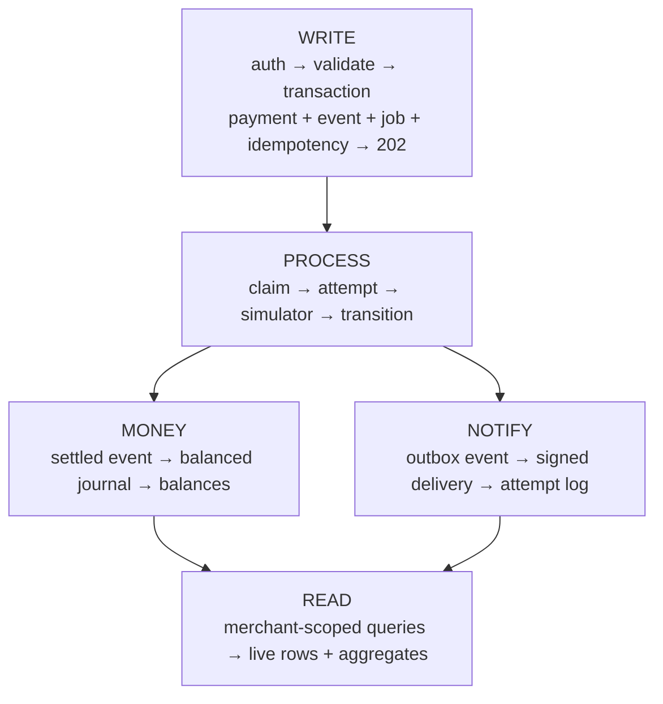
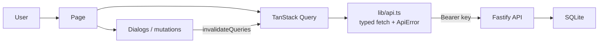

<div align="center">

# PayFlow — Deep Dive

**The concepts behind the machine, and the knowledge required to work on it.**

Companion to [`README.md`](./README.md), which is the reference.
This document is the understanding.

</div>

> [!NOTE]
> **Simulation only.** No card data, no processor, no money. Integer paise in a
> local SQLite file.

---

## How to read this

| You are…                  | Read                                                         |
| ------------------------- | ------------------------------------------------------------ |
| New to the codebase       | Part I → Part II → Part V                                    |
| Reviewing or interviewing | Part I → Part III → Part VII                                 |
| Building a feature        | Part V (recipes) → Part I (the concept it touches) → Part VI |
| On call                   | Part V (debugging) → README runbook                          |

**Legend:** `Concept` = the idea · `Where` = the file that implements it ·
`Lab` = an exercise in Part VI.

---

# Part I — The sixteen concepts

PayFlow is eighteen ideas wearing a payment costume. Learn these and the codebase
becomes predictable.

| #   | Concept                 | The claim                                                 | Where                           |
| --- | ----------------------- | --------------------------------------------------------- | ------------------------------- |
| 1   | HTTP status semantics   | `202` means _accepted_, not _done_                        | `routes/payments.ts`            |
| 2   | Bearer auth             | A secret string proves identity; the server stores a hash | `services/auth.ts`              |
| 3   | Transactions            | All-or-nothing writes                                     | `db.ts`, `services/*`           |
| 4   | Concurrency             | Two writers, one truth                                    | `services/refunds.ts`           |
| 5   | Idempotency             | Same request → same answer                                | `services/idempotency.ts`       |
| 6   | State machines          | Only legal moves exist                                    | `domain.ts`                     |
| 7   | Durable jobs            | Work that survives a crash                                | `services/jobs.ts`, `worker.ts` |
| 8   | At-least-once delivery  | A job may run twice                                       | `worker.ts`                     |
| 9   | Reconciliation          | Resolve the uncertain                                     | `worker.ts`                     |
| 10  | Double-entry accounting | Debits = credits, always                                  | `services/ledger.ts`            |
| 11  | Keyset pagination       | Stable cursors over moving data                           | `domain.ts`                     |
| 12  | Cache invalidation      | The UI must reflect the server                            | `apps/web/src`                  |
| 13  | Transactional outbox    | The event is written with the change, then delivered      | `services/webhooks.ts`          |
| 14  | Signed payloads         | The receiver proves authenticity                          | `services/webhooks.ts`          |
| 15  | Tokenized instruments   | No card number is ever stored                             | `services/payment-methods.ts`   |
| 16  | Derived balance guards  | Payouts are bounded by what was actually collected        | `services/payouts.ts`           |
| 17  | Capability documents    | A client should not have to guess what exists             | `routes/meta.ts`                |
| 18  | Contract-first docs     | Every operation has a stable `operationId`                | `apps/api/src/routes/*`         |

---

### 1. Status codes are promises

**Concept.** A status code describes _when_ the work finishes, not merely whether
the request was valid.

| Code  | Promise                          | PayFlow                                    |
| ----- | -------------------------------- | ------------------------------------------ |
| `200` | Done, body final                 | Reads, cancellation, stats                 |
| `202` | Accepted; not final              | Create payment, create refund              |
| `400` | Malformed request                | Zod validation                             |
| `401` | Identity unknown                 | Missing/invalid bearer key                 |
| `403` | Identity known, action forbidden | Simulator controls disabled                |
| `404` | Not yours, or not there          | Tenant isolation, unknown route            |
| `409` | Conflicts with reality           | Key reuse, over-refund, illegal transition |
| `429` | Slow down                        | Rate limit                                 |
| `500` | Our fault                        | Unhandled error                            |

**Why it matters here.** `POST /v1/payments` returns `202` because the processor
has not been called yet. Returning `200` with `status: "created"` invites
clients to ship goods for a payment that later fails. The contract must match
reality, and reality is asynchronous.

**Where.** `routes/payments.ts` (`reply.code(202)`), `app.ts` (one error handler
for every shape).

**Know it if you can answer:** why does the API also send `Location` and
`x-request-id`? (A resolvable pointer to the resource, and a correlation id
that survives logs and support tickets.)

---

### 2. Authentication: hash, pepper, constant-time compare

**Concept.** The server stores a _hash_ of the credential, never the credential
itself. The client presents the secret on every request.

**The implementation**

1. `generateApiKey()` → `sk_test_` + 32 random base64url characters.
2. Stored: a display prefix (`sk_test_` + 8 chars) and
   `HMAC-SHA256(rawKey, pepper)`.
3. `resolveApiKey()` finds the row by prefix, then compares with
   `crypto.timingSafeEqual`.

```ts
// apps/api/src/services/auth.ts
export function hashApiKey(raw: string, pepper: string): string {
  return createHmac("sha256", pepper).update(raw).digest("hex");
}
```

**The pepper** is a server-side secret mixed into the HMAC. A leaked database
yields nothing without it. Production refuses to boot with the default pepper.

**Constant-time compare** removes the timing side channel: response time no
longer leaks how many leading bytes matched.

**Tenancy.** Once resolved, `request.merchant.id` rides on every request and
every query filters by it. Another merchant's payment is `404`, never `403` —
`403` would confirm the resource exists.

**Know it if you can answer:** why store a prefix _and_ a hash? (The prefix is
an index that finds the row; the hash is the proof. The prefix cannot be used
to authenticate.)

---

### 3. Transactions, and what SQLite insists on

**Concept.** A transaction is an all-or-nothing unit of work.

| Property    | Meaning in PayFlow                                                       |
| ----------- | ------------------------------------------------------------------------ |
| Atomicity   | Payment + event + job + idempotency record commit together or not at all |
| Consistency | A payment always holds a legal status; the books always balance          |
| Isolation   | Two writers cannot interleave inside `IMMEDIATE` transactions            |
| Durability  | Committed data survives a crash (WAL, `synchronous = NORMAL`)            |

**SQLite rules that shaped the design**

| Rule                 | Consequence                                                                   |
| -------------------- | ----------------------------------------------------------------------------- |
| One writer at a time | Write transactions serialize; `busy_timeout = 30000` waits instead of failing |
| WAL mode             | Readers never block the writer                                                |
| `BEGIN IMMEDIATE`    | The write lock is taken at transaction start, closing read-then-write races   |
| `changes !== 1`      | A conditional `UPDATE` that matched nothing is the concurrency signal         |

```ts
// apps/api/src/services/payments.ts
return db.transaction(
  (tx) => {
    /* transition + cancel pending jobs */
  },
  { behavior: "immediate" },
);
```

**Know it if you can answer:** why `behavior: "immediate"` and not the default
deferred transaction? (Deferred lets two transactions read the same rows before
either writes — a lost update waiting to happen.)

---

### 4. Concurrency: the refund race

**Concept.** Two requests interleave. Any "check, then act" sequence is broken
by definition.

**Broken**

```ts
const payment = getPayment(db, merchantId, paymentId);            // read
if (payment.amountMinor - payment.refundedMinor < amount) {        // check
  db.update(payments).set({ refundedMinor: … }).run();              // write
}
```

Two concurrent refunds both pass the check. The merchant loses money.

**Correct**

```sql
UPDATE payments
SET refund_reserved_minor = refund_reserved_minor + :amount
WHERE id = :id
  AND status IN ('succeeded','partially_refunded')
  AND refunded_minor + refund_reserved_minor + :amount <= amount_minor;
```

```ts
// apps/api/src/services/refunds.ts
if (reserved.changes !== 1) throw errors.refundCapacity();
```

Either the row updated (capacity existed) or it did not (someone else took it).
There is no window between the check and the write.

**Three concurrency tools, one idea each**

| Tool                        | Where                                          | Prevents                            |
| --------------------------- | ---------------------------------------------- | ----------------------------------- |
| Atomic conditional `UPDATE` | refund reservation                             | Two refunds spending one balance    |
| Unique constraint           | `idempotency_records`                          | One intent creating two payments    |
| Compare-and-set             | `transitionPayment` (`WHERE status = current`) | Two workers applying one transition |

**Know it if you can answer:** why is a database constraint a better arbiter than
an application-level check? (Application checks race with each other; the
database is the single serializing authority.)

---

### 5. Idempotency

**Concept.** The client sends a request, the network times out, and the client
cannot know whether the server created anything. It retries. Without
idempotency, the merchant is charged twice.

**Contract**

| Situation                 | Behaviour                                                |
| ------------------------- | -------------------------------------------------------- |
| New key                   | Work runs → `202`                                        |
| Same key, same body       | Original response replayed, `Idempotency-Replayed: true` |
| Same key, different body  | `409 idempotency_key_reused`                             |
| Same key, still in flight | `409 idempotency_in_progress`                            |
| Same key, TTL expired     | New operation → `202`                                    |

**The fingerprint.** The key alone is insufficient; the body must match too:

```ts
const requestHash = sha256(
  JSON.stringify({
    amount_minor,
    currency,
    customer_id,
    description,
    scenario,
  }),
);
```

**The transaction.** Record, work, and response snapshot commit together:

```text
BEGIN IMMEDIATE
  INSERT idempotency_records (status = 'in_progress')
  INSERT payments (status = 'created')
  INSERT payment_events ('payment.created')
  INSERT jobs ('process_payment')
  UPDATE idempotency_records (status = 'completed', response_body = …)
COMMIT
```

A crash mid-transaction rolls back everything: no orphan payment, no orphan
job, no half-replayed record.

**TTL.** Records carry `expires_at` (24 h by default). An expired key is reset
in place and treated as a new intent — a retry token, not a permanent lock.

**Know it if you can answer:** why does a replay return the _original_ body
(`status: "created"`) instead of today's status? (The stored body is exactly
what the first caller received. Re-deriving it would break the "same answer"
promise. Live state comes from `GET`.)

---

### 6. State machines

**Concept.** States plus the only legal moves between them. Illegal moves are
bugs, so they are rejected loudly rather than absorbed.

```ts
// apps/api/src/domain.ts
const ALLOWED_TRANSITIONS: Record<PaymentStatus, readonly PaymentStatus[]> = {
  created: ["processing", "canceled"],
  processing: ["succeeded", "failed", "unknown"],
  unknown: ["succeeded", "failed"],
  succeeded: ["partially_refunded", "refunded"],
  partially_refunded: ["partially_refunded", "refunded"],
  failed: [],
  canceled: [],
  refunded: [],
};
```

**What the table buys**

| Without                                         | With                                             |
| ----------------------------------------------- | ------------------------------------------------ |
| "Failed" then "Succeeded" — a double settlement | Impossible: `failed` has no outgoing edge        |
| A refund against a `created` payment            | `409 payment_not_refundable`                     |
| Cancel after processing started                 | `409 payment_not_cancelable`                     |
| Silent corruption                               | `409 invalid_state_transition` plus an event row |

**Transitions are events.** Every move writes a `payment_events` row
(`from_status`, `to_status`, `reason`). The console renders that log as a
timeline; the log is the audit trail.

**Compare-and-set transitions**

```ts
const result = tx
  .update(payments)
  .set(update)
  .where(and(eq(payments.id, paymentId), eq(payments.status, current.status)))
  .run();
```

Two workers racing to move `processing → succeeded`: one wins, the other sees
`changes !== 1`, re-reads, and stops.

**Know it if you can answer:** which states are terminal, and why is `unknown`
not one of them? (It is unresolved, not finished. It can still become
`succeeded` or `failed`.)

---

### 7. Durable jobs: leases, retries, dead letters

**Concept.** A job row says "do this later". Workers poll, claim, and retry.

```text
pending ──claim──> running ──ok──> succeeded
   ▲                 ├─ throw ──> retrying ──due──> running
   │                 └─ lease expired ──> retrying
   └── canceled (aggregate canceled first)

retrying ──budget exhausted──> dead
```

**Claiming** is a conditional update, so two workers cannot own one job:

```ts
const claimed = t.update(jobs)
  .set({ status: "running", attempts, claimedBy: workerId, leaseExpiresAt: … })
  .where(and(eq(jobs.id, candidate.id), inArray(jobs.status, ["pending", "retrying"])))
  .run();
if (claimed.changes !== 1) return null;
```

**Leases** make crashes recoverable. A worker that dies leaves an expired
`lease_expires_at`; the next poll resets the row to `retrying`. No deadlock, no
lost work.

**Backoff** stops a failing dependency from being hammered:

```ts
export function backoffSeconds(attempts: number): number {
  return Math.min(300, 2 ** attempts * 2); // 4s, 8s, 16s … capped at 5 min
}
```

**Dead letters.** After `max_attempts` (default 5) the job becomes `dead` with
`last_error` recorded. It stops retrying and stays inspectable.

**Know it if you can answer:** why is the job row written in the _same_
transaction as the payment? (Otherwise a crash between the two leaves a payment
nobody will ever process — the classic lost-work bug.)

---

### 8. At-least-once delivery, idempotent handlers

**Concept.** Queues cannot promise exactly-once. They promise **at least
once**: the handler will run, and it may run again. Therefore handlers must be
safe to repeat.

| Defence                         | Where                                                                       |
| ------------------------------- | --------------------------------------------------------------------------- |
| Handlers stop on terminal state | `processPayment` returns early unless the payment is `created`/`processing` |
| One journal per source          | `UNIQUE (source_type, source_id)` on `ledger_transactions`                  |
| Posting checks before writing   | `postJournal` returns the existing journal instead of posting twice         |
| Refund settlement is guarded    | `settleRefund` requires a matching reservation (`gte`)                      |

**Know it if you can answer:** a job runs twice and the payment is already
`succeeded`. What must not happen? (A second journal. That is why journals are
unique per source id and ledger entries are immutable.)

---

### 9. Reconciliation: the honest third answer

**Concept.** Some operations have three outcomes: success, failure, and _no
answer yet_. Payment systems must model the third one.

```text
timeout ──▶ "failed"      ✗ the charge may have been captured; money is lost
timeout ──▶ "unknown"     ✓ then lookup() → succeeded | failed
```

**The flow**

1. The simulator returns `timeout` → the payment moves to `unknown`.
2. The worker enqueues `reconcile_payment` ~5 s later with the processor
   reference.
3. `lookupSimulation(reference)` asks the processor what really happened.
4. The simulator is deterministic, so the answer is stable.

Refunds follow the same path (`unknown` → `reconcile_refund`).

> [!IMPORTANT]
> A timeout is never a decline. Simplifying that away turns the ledger into
> fiction.

---

### 10. Double-entry accounting

**Concept.** Every rupee that moves is a balanced journal: total debits equal
total credits. Nothing is edited; mistakes are corrected with new journals.

| Account              | Kind      | Meaning                     | Normal balance |
| -------------------- | --------- | --------------------------- | -------------- |
| `processor_clearing` | asset     | Money the processor owes us | debit          |
| `merchant_payable`   | liability | Money we owe the merchant   | credit         |

| Event            | Debit              | Credit             |
| ---------------- | ------------------ | ------------------ |
| Payment succeeds | processor clearing | merchant payable   |
| Refund succeeds  | merchant payable   | processor clearing |

**Algebra** (₹249 paid, ₹50 refunded)

```text
payment  : debit clearing 24,900  →  clearing = +24,900
           credit payable 24,900  →  payable  = +24,900
refund   : debit payable  5,000   →  payable  = +19,900
           credit clearing 5,000  →  clearing = +19,900
```

Debits (24,900) equal credits (24,900). Both accounts end at ₹199.00.

**Immutability is physical**

```sql
CREATE TRIGGER trg_ledger_entries_no_update
BEFORE UPDATE ON ledger_entries
BEGIN
  SELECT RAISE(ABORT, 'ledger entries are immutable');
END;
```

**Why this rigour for a simulator:** the concurrency, idempotency, and
accounting patterns are the deliverable. Swapping in a real processor changes
one function; the rest survives.

**Know it if you can answer:** why does a _failed_ payment post no journal?
(Nothing settled. A journal would record a movement of money that never
happened.)

---

### 11. Keyset pagination

**Concept.** `OFFSET 20` means "skip 20 rows _as ordered right now_". Insert a
row and every later page shifts — clients see duplicates and missed rows.

```ts
// apps/api/src/domain.ts
export function encodeCursor(row: { createdAt: string; id: string }): string {
  return Buffer.from(`${row.createdAt}|${row.id}`, "utf8").toString(
    "base64url",
  );
}
```

The next page selects rows strictly after the anchor:

```ts
or(
  lt(payments.createdAt, cursor.createdAt),
  and(eq(payments.createdAt, cursor.createdAt), lt(payments.id, cursor.id)),
);
```

`created_at` + `id` is a total order, so nothing is skipped or repeated even
when many rows share a timestamp. The client never sees the internals.

**Know it if you can answer:** why include `id` when `created_at` looks
sufficient? (Ties. Many rows can share the same millisecond.)

---

### 12. The browser side: cache, polling, invalidation

**Concept.** The browser holds a cached copy of server state. Decide when to
trust it, when to refetch, when to discard it.

| Rule                                   | Where                                      | Why                                           |
| -------------------------------------- | ------------------------------------------ | --------------------------------------------- |
| `staleTime: 2000`                      | `App.tsx`                                  | No refetch storms while navigating            |
| `retry: 1`                             | `App.tsx`                                  | One transient failure should not spam the API |
| `refetchOnWindowFocus: false`          | `App.tsx`                                  | The console polls on purpose instead          |
| Poll 1.2 s while a payment is _active_ | `payment-detail.tsx`                       | Shows the settlement happening                |
| Poll 2.5 s for a payment's refunds     | `payment-detail.tsx`                       | Refunds settle out-of-band                    |
| Poll 5 s overview, 15 s series         | `overview.tsx`                             | Alive without websockets                      |
| Invalidate on mutation                 | `payment-dialog.tsx`, `payment-detail.tsx` | Show the effect of the write at once          |

```ts
// apps/web/src/components/payment-detail.tsx
refetchInterval: (query) => {
  const status = query.state.data?.status;
  return status && ACTIVE_STATUSES.has(status) ? 1200 : false;
},
```

Polling stops the moment the payment reaches a settled state.

**Know it if you can answer:** why invalidate `overview` and `timeseries` after
creating a payment? (They are derived aggregates; the write changed their
inputs, so their cached copies are stale by definition.)

---

### 13. The transactional outbox

**Concept.** If a business change must notify someone else, the notification
must be written in the same transaction as the change. Otherwise there is a
window where the money moved and the message was lost, or the message was sent
for a change that rolled back.

**The implementation**

```text
BEGIN IMMEDIATE
  UPDATE payments SET status = 'succeeded' …
  INSERT ledger_transactions / ledger_entries …
  INSERT webhook_events (status = 'pending', payload = …)
  INSERT jobs (kind = 'deliver_webhooks', aggregate_id = event id)
COMMIT
```

The event is a row, not a message on a wire. A separate worker picks it up
later, so a slow or dead endpoint cannot slow down or fail the payment.

**Delivery is per endpoint.** One event may have several endpoints. The worker
delivers to each active endpoint, records a `webhook_deliveries` row per
attempt, and never delivers twice to an endpoint that already succeeded — the
successful endpoints are read back from the delivery log before a retry.

**Know it if you can answer:** what is the failure mode of publishing to a queue
_before_ committing the business change? (The event can be delivered for a
change that never committed. The outbox inverts the order and makes the two
atomic.)

### 14. Signed payloads

**Concept.** A receiver must be able to prove that a payload came from you and
was not modified in transit.

```ts
const signature = createHmac("sha256", secret)
  .update(`${timestamp}.${body}`)
  .digest("hex");
```

The header is `X-PayFlow-Signature: t=<unix-seconds>,v1=<hex>`. The receiver
recomputes the HMAC over `timestamp + "." + body` and compares. Including the
timestamp in the signed material means a captured payload cannot be replayed
indefinitely; the receiver chooses its own tolerance window.

The secret is returned once, at endpoint creation, and stored hashed-free but
never re-displayed.

**Know it if you can answer:** why sign `timestamp.body` instead of `body`?
(The timestamp binds the signature to a moment, so a captured payload is
rejected outside the receiver's tolerance window.)

### 15. Tokenized instruments

**Concept.** A payment method is a reference to an instrument the merchant
already holds, not a copy of the instrument.

```text
pm_9f2c…   card   "Acme corporate card"   last4 4242   visa   11/2030
```

There is no card number field, because there is no card number to store. A
method can be disabled, which makes it unusable for new payments while leaving
existing payments untouched. The instrument also changes the simulated
outcome distribution, so a UPI payment is not a card payment with a different
label.

**Know it if you can answer:** what breaks if a merchant stores the last four
digits and the network? (Nothing that matters for the simulator: there is no
authorization to perform, only a deterministic outcome to produce.)

### 16. Balance-bounded movements

**Concept.** Some operations are only legal against a balance the merchant
actually holds. Because balances are derived from journal entries rather than
stored, the guard is a read inside the write transaction:

```ts
const available = accountBalance(tx, merchantId, "merchant_payable");
if (available < amount) throw errors.insufficientBalance(…);
```

The `IMMEDIATE` transaction holds the write lock, so the balance cannot move
between the check and the journal that follows it.

**Know it if you can answer:** why is a read inside the transaction safe here,
when the refund reservation needed a conditional `UPDATE`? (Because
`IMMEDIATE` takes the write lock at the start of the transaction, so no other
writer can change the balance between the read and the write. A conditional
`UPDATE` is still used where the invariant must also hold in the database.)

---

### 17. Capability documents

**Concept.** A client should be able to discover what a deployment supports
without reading prose. `GET /v1` returns the resource list, the simulator
vocabularies, the webhook event types, the error codes, and the limits.

```json
{
  "object": "capabilities",
  "api_version": "1.0.0",
  "resources": [
    { "name": "webhooks", "endpoints": ["POST /v1/webhook_endpoints", "…"] }
  ],
  "simulator": {
    "scenarios": ["approve", "decline", "timeout", "transient", "auto"]
  },
  "webhooks": { "event_types": ["payment.succeeded", "…"] },
  "limits": { "max_amount_minor": 1000000000, "default_page_size": 25 },
  "error_codes": ["insufficient_balance", "…"]
}
```

**Why it matters.** The document is generated from the same constants the
implementation uses — `SCENARIOS`, `PAYMENT_METHOD_TYPES`, `WEBHOOK_EVENT_TYPES`,
`OUTCOME_DISTRIBUTIONS` — so it cannot drift from the code. A client bootstrapper
or an SDK generator reads it once and knows the whole surface.

### 18. Contract-first documentation

**Concept.** An operation without a stable name is an operation a generated SDK
cannot expose. Every route declares an `operationId`, and the OpenAPI document
carries the tag taxonomy, the version, and the servers.

```ts
schema: {
  tags: ["Payments"],
  summary: "Create a payment",
  operationId: "createPayment",
  response: { 202: PaymentSchema },
}
```

Examples are injected by a per-route transform, because the OpenAPI plugin
rebuilds the media objects and drops anything a Zod schema cannot carry.
The transform reads the operation id, looks up the example, and attaches it to
the request body and the success response.

**Know it if you can answer:** what breaks in a generated SDK when two
operations share an `operationId`? (One method overwrites the other, and the
client silently calls the wrong endpoint.)

---

# Part II — End-to-end traces

### The four paths



---

### Trace 1 — Create, settle, post

```text
POST /v1/payments
  Authorization: Bearer sk_test_…
  Idempotency-Key: order_1042_attempt_1
  { "amount_minor": 24900, "simulator_scenario": "approve" }
```

**API**

| Step | Code                                   | Effect                                                                      |
| ---- | -------------------------------------- | --------------------------------------------------------------------------- |
| 1    | `app.ts` `authenticate`                | Bearer → merchant id on the request                                         |
| 2    | `schemas.ts` `CreatePaymentBody`       | Integer amount > 0, ≤ 1e9, currency INR                                     |
| 3    | `services/payments.ts` `createPayment` | Hash the body, then one transaction                                         |
| 4    | the transaction                        | `payments` row, `payment_events` row, `jobs` row, `idempotency_records` row |
| 5    | `routes/payments.ts`                   | `202` + `Location: /v1/payments/pay_…`                                      |

```sql
BEGIN IMMEDIATE;
  INSERT INTO payments (id, merchant_id, amount_minor, currency, status, …)
        VALUES ('pay_…', 'mer_…', 24900, 'INR', 'created', …);
  INSERT INTO payment_events (payment_id, type, from_status, to_status)
        VALUES ('pay_…', 'payment.created', NULL, 'created');
  INSERT INTO jobs (kind, aggregate_id, payload, status, next_run_at)
        VALUES ('process_payment', 'pay_…', '{"payment_id":"pay_…","scenario":"approve"}', 'pending', …);
  INSERT INTO idempotency_records (…, status, expires_at)
        VALUES (…, 'in_progress', <now + 24h>);
COMMIT;
```

**Worker** (within ~400 ms)

| Step | Code                               | Effect                                                |
| ---- | ---------------------------------- | ----------------------------------------------------- |
| 1    | `jobs.ts` `claimNextJob`           | `pending → running`, `attempts + 1`, lease set        |
| 2    | `worker.ts` `processPayment`       | Insert `payment_attempts` row; `created → processing` |
| 3    | `domain.ts` `runSimulation`        | `approve` → `{ outcome: "succeeded" }`                |
| 4    | `worker.ts` `applyPaymentOutcome`  | `processing → succeeded`; event `payment.succeeded`   |
| 5    | `services/ledger.ts` `postJournal` | One balanced journal of 24,900                        |
| 6    | `jobs.ts` `completeJob`            | `running → succeeded`                                 |

```text
processor_clearing   DEBIT   24,900
merchant_payable     CREDIT  24,900      debits = credits ✅
```

**Read**

```json
{
  "status": "succeeded",
  "failure_code": null,
  "attempts": [
    {
      "attempt_number": 1,
      "status": "succeeded",
      "processor_reference": "proc_…"
    }
  ],
  "events": [
    { "type": "payment.created", "to_status": "created" },
    { "type": "payment.processing", "to_status": "processing" },
    { "type": "payment.succeeded", "to_status": "succeeded" }
  ]
}
```

---

### Trace 2 — The idempotent replay

```text
Request A (key K, body B) ──┐
                             ├──▶ BEGIN IMMEDIATE
Request B (key K, body B) ──┘         │
                                       ├── A: no record → insert in_progress → work → completed
                                       └── B: record found, hash matches, completed
                                              → stored body + Idempotency-Replayed: true
```

| Variant                       | Path                                                      |
| ----------------------------- | --------------------------------------------------------- |
| Same key, different body      | Hash differs → `409 idempotency_key_reused`               |
| Same key, first still running | `status !== "completed"` → `409 idempotency_in_progress`  |
| Same key after TTL            | Record expired → reset in place → new operation           |
| No key at all                 | `withIdempotency(null, …)` → plain transaction, no record |

---

### Trace 3 — Timeout, then reconciliation

```text
attempt 1 → runSimulation → { outcome: "timeout", failureCode: "processor_timeout" }
           ↓
payment: processing → unknown              (event: payment.unknown)
           ↓
enqueue reconcile_payment (run_at = now + 5s)
           ↓
attempt 2 → lookupSimulation(reference)
           ├── succeeded → unknown → succeeded (+ journal if not yet posted)
           └── declined  → unknown → failed
```

---

### Trace 4 — Two refunds race for the last ₹100

```text
payment: amount 24,900 | refunded 0 | reserved 0
Refund A: 24,800        Refund B: 200
```

| Moment | Refund A                                         | Refund B                                         |
| ------ | ------------------------------------------------ | ------------------------------------------------ |
| t0     | `BEGIN IMMEDIATE` — holds the write lock         | waits                                            |
| t1     | `0 + 0 + 24,800 ≤ 24,900` ✅ → reserved = 24,800 | waits                                            |
| t2     | commits                                          | acquires the lock                                |
| t3     | —                                                | `0 + 24,800 + 200 = 25,000 > 24,900` ❌          |
| t4     | —                                                | `changes === 0` → `409 refund_exceeds_remaining` |

The loser never reserved a rupee. Check and write are one statement, so the
race has no window. If A's refund later fails, its reservation is released and
B can then succeed.

---

### Trace 5 — Cancel a reserved refund

```text
t0  POST /v1/refunds           → refund reserved, capacity held, job queued
t1  POST /v1/refunds/:id/cancel
      ├── status must be "reserved" (else 409 refund_not_cancelable)
      ├── refund_reserved_minor -= amount   (guarded by gte)
      ├── refund → canceled
      ├── pending job for that refund canceled
      └── payment event "refund.canceled"
t2  worker polls               → the job is canceled; the refund is never submitted
```

If the worker already claimed the job, the refund is `processing` and the
cancel is refused — the release would race the settlement. One winner, always.

---

### Trace 6 — The worker dies mid-flight

```text
t0  worker claims job        → running, lease_expires_at = now + 60s
t1  worker records attempt   → payment_attempts row exists
t2  💥 process killed        → job stays "running"; the lease will expire
t3  another worker polls     → lease expired → row reset to "retrying"
t4  job is due again         → claimed again → a second attempt is recorded
t5  outcome applied          → the payment settles exactly once
```

Two attempts may exist. One settlement does.

---

### Trace 7 — Cancel while the worker is starting

| Timing                                  | Result                                                 |
| --------------------------------------- | ------------------------------------------------------ |
| Status is still `created`               | `created → canceled`; pending jobs canceled            |
| Worker already moved it to `processing` | `409 payment_not_cancelable`                           |
| Job already running                     | Not recalled; it observes the terminal state and stops |

---

### Trace 8 — A webhook delivery

```text
POST /v1/payments                       → payment created, event written
BEGIN IMMEDIATE
  INSERT payments (status = 'created')
  INSERT webhook_events (type = 'payment.created', status = 'pending')
  INSERT jobs (kind = 'deliver_webhooks', aggregate_id = evt_…)
COMMIT
        │
        ▼  worker claims the delivery job
   POST https://merchant/hook
     headers: x-payflow-event: payment.created
              x-payflow-event-id: evt_…
              x-payflow-delivery: evt_….1
              x-payflow-signature: t=1799999999,v1=<hmac>
        │
        ├── 2xx → delivery row (delivered) → event status 'delivered'
        └── else → delivery row (failed) → event status 'failed'
                    → job retried with backoff → endpoints already
                      delivered are skipped on the next attempt
```

A delivery that exhausts its retry budget marks the event `dead`. The event
rows and the delivery rows are both readable, so a merchant can always answer
"did you get it, and what did you get?".

### Trace 9 — A payout

```text
POST /v1/payouts { amount_minor: 5000, destination: "bank://hdfc-7788" }
        │
        ▼
BEGIN IMMEDIATE
  available = accountBalance(merchant_payable)   ← derived from journal entries
  if available < 5000 → 409 insufficient_balance
  INSERT payouts (status = 'pending')
  INSERT jobs (kind = 'process_payout')
COMMIT
        │
        ▼  worker
  payout → processing, processor reference assigned
  simulate → succeeded
  BEGIN IMMEDIATE
    UPDATE payouts SET status = 'paid'
    INSERT ledger_transactions (source_type = 'payout', source_id = payout id)
    INSERT ledger_entries  merchant_payable   DEBIT   5,000
                        processor_clearing CREDIT  5,000
    INSERT webhook_events (payout.paid)
  COMMIT
```

A payout timeout becomes `unknown` and is reconciled exactly like a payment
timeout.

### Trace 10 — A lost dispute

```text
POST /v1/disputes { payment_id: pay_…, amount_minor: 2000, reason: "not received" }
        │
        ▼  payment must be succeeded or partially_refunded
   dispute (status = 'open') + dispute.opened event
        │
        ▼  POST /v1/disputes/:id/resolve { outcome: "lost" }
   BEGIN IMMEDIATE
     INSERT ledger_transactions (source_type = 'dispute', source_id = dispute id)
     INSERT ledger_entries  merchant_payable   DEBIT   2,000
                         processor_clearing CREDIT  2,000
     UPDATE disputes SET status = 'lost', resolved_at = now
     INSERT webhook_events (dispute.lost)
   COMMIT
```

A won dispute posts nothing: the merchant keeps the claim, so there is no
movement to record.

---

# Part III — The money, worked out

### Balance algebra

```text
refundable_minor = amount_minor − refunded_minor − refund_reserved_minor
```

| Field                   | Meaning           | Changes when                                   |
| ----------------------- | ----------------- | ---------------------------------------------- |
| `amount_minor`          | Original charge   | never                                          |
| `refunded_minor`        | Settled refunds   | a refund succeeds                              |
| `refund_reserved_minor` | Refunds in flight | a refund is created, then released or consumed |
| `refundable_minor`      | Still refundable  | derived                                        |

### A worked week

| Event                 |  Amount | clearing | payable |     debits |       credits |
| --------------------- | ------: | -------: | ------: | ---------: | ------------: |
| Payment A succeeds    |  24,900 |  +24,900 | +24,900 |     24,900 |        24,900 |
| Payment B succeeds    |  10,000 |  +34,900 | +34,900 |     34,900 |        34,900 |
| Refund on A (partial) |  −5,000 |   29,900 |  29,900 |     34,900 |        34,900 |
| Refund on B (full)    | −10,000 |   19,900 |  19,900 |     44,900 |        44,900 |
| **Trial balance**     |         |          |         | **44,900** | **44,900** ✅ |

### What moves the two accounts

| Business event   | `processor_clearing` (asset) | `merchant_payable` (liability) |
| ---------------- | ---------------------------- | ------------------------------ |
| Payment succeeds | +amount (debit)              | +amount (credit)               |
| Refund succeeds  | −amount (credit)             | −amount (debit)                |
| Payout paid      | −amount (credit)             | −amount (debit)                |
| Dispute lost     | −amount (credit)             | −amount (debit)                |
| Dispute won      | unchanged                    | unchanged                      |

A refund reverses a specific payment; a payout settles the accumulated
balance; a lost dispute returns money to the processor. All three reduce the
merchant's claim and the clearing balance by the same amount, so the two
accounts stay equal in a healthy merchant.

### Net volume is not the ledger balance

| Number         | Definition                          | Source      |
| -------------- | ----------------------------------- | ----------- |
| Gross volume   | Sum of _successful_ payment amounts | `stats.ts`  |
| Refunded       | Sum of `refunded_minor`             | `stats.ts`  |
| Net volume     | Gross − refunded                    | `stats.ts`  |
| Ledger balance | `Σ debits − Σ credits` per account  | `ledger.ts` |

They agree in a healthy system. When they disagree, look for a failed refund
(released reservation) or a payment that settled without a journal. The
settlement report is the bridge: it subtracts refunds, dispute losses, and
payouts from captured volume, and the result should equal the change in the
payable balance over the same day.

### Success rate

```text
success_rate = succeeded / (succeeded + failed)
```

`created`, `processing`, `unknown`, and `canceled` are excluded: they are not
outcomes yet. Ten pending payments and zero failures report 0% until those
payments resolve — deliberately conservative.

---

# Part IV — The console

### Data flow



### Design intent

| Decision                                  | Reason                                            |
| ----------------------------------------- | ------------------------------------------------- |
| Ink and parchment, saffron accents        | Reads like a printed ledger, not a SaaS dashboard |
| Fraunces / Inter / JetBrains Mono         | Three voices: editorial, readable, technical      |
| Status as stamped mono badges             | Status is metadata, not prose                     |
| Grain, ambient canvas, orbs               | Depth without noise; reduced motion respected     |
| Count-up KPIs                             | Numbers arrive instead of blinking into place     |
| Live clock and pulse feed                 | The console is alive but never lies about data    |
| Mobile: status moves into the amount cell | Amounts stay visible on small screens             |
| Code surfaces stay dark in light mode     | Terminal contrast beats theme consistency         |

### Where the craft lives

| File                          | Role                                                           |
| ----------------------------- | -------------------------------------------------------------- |
| `components/ambient.tsx`      | Canvas flow field, orbs, grid; theme-aware colours             |
| `components/motion.tsx`       | `Reveal`, `useAnimatedNumber`, `useReducedMotion`, `LiveClock` |
| `components/ui.tsx`           | Buttons, cards, badges, inputs, table, dialog, tabs, toasts    |
| `components/status.tsx`       | Status → label + icon + semantic colour                        |
| `components/volume-chart.tsx` | Recharts area with gradient, peak marker, crafted tooltip      |
| `pages/methods.tsx`           | Instruments: create, disable, filter                           |
| `pages/webhooks.tsx`          | Endpoints, the one-time secret, events, deliveries, sink       |
| `pages/treasury.tsx`          | Payouts and disputes, with the payable balance in view         |
| `pages/guide.tsx`             | The in-app architecture chapter                                |

### The console routes

| Route         | Reads                               | Writes                                  |
| ------------- | ----------------------------------- | --------------------------------------- |
| `/`           | Overview, time series               | —                                       |
| `/payments`   | Payments, one payment, its refunds  | Create, cancel, refund                  |
| `/refunds`    | Refunds                             | —                                       |
| `/ledger`     | Accounts, journals                  | —                                       |
| `/methods`    | Payment methods                     | Create, disable                         |
| `/webhooks`   | Endpoints, events, deliveries, sink | Create, disable                         |
| `/treasury`   | Payouts, disputes, accounts         | Create payout, open and resolve dispute |
| `/playground` | —                                   | Raw requests, including cURL output     |

---

# Part V — Working on the code

### Decision table

| I want to…                  | Touch                                                                                           | Watch out for                                                         |
| --------------------------- | ----------------------------------------------------------------------------------------------- | --------------------------------------------------------------------- |
| Add a payment status        | `domain.ts` (`PAYMENT_STATUSES`, `ALLOWED_TRANSITIONS`), `schemas.ts`, `schema-sql.ts`, `db.ts` | Add a numbered migration to update the DB `CHECK` for existing files  |
| Add a refund status         | `REFUND_STATUSES`, `schema-sql.ts` (`refunds`), `web/src/lib/api.ts`                            | `unknown` must be allowed in the `refunds` CHECK                      |
| Add an endpoint             | `routes/*.ts` + a service function                                                              | Zod request _and_ response schemas; `preHandler: [app.authenticate]`  |
| Change a response field     | `services/serializers.ts`, `schemas.ts`, `web/src/lib/api.ts`                                   | The web client type changes in the same commit                        |
| Change the ledger           | `services/ledger.ts`                                                                            | Journals must stay balanced; entries are immutable                    |
| Change retry behaviour      | `services/jobs.ts`, `domain.ts` (`backoffSeconds`), `config.ts`                                 | One source of truth for the formula                                   |
| Add a simulator scenario    | `domain.ts` (`SCENARIOS`, `runSimulation`), `web/src/lib/api.ts`, playground presets            | Production keeps simulator controls off                               |
| Add a console page          | `pages/*.tsx`, `App.tsx`, `layout.tsx` (`NAV` + `TITLES`)                                       | Add a title or the header shows "PayFlow"                             |
| Add a payment method        | `services/payment-methods.ts`, `routes/methods.ts`                                              | A card needs a four-digit `last4`; there is no PAN field              |
| Add a webhook event         | `domain.ts` (`WEBHOOK_EVENT_TYPES`), `services/webhooks.ts`                                     | Emit it inside the business transaction, never after                  |
| Change the webhook contract | `services/webhooks.ts` (`signPayload`, payload shape)                                           | The signature covers `timestamp.body`; changing it breaks receivers   |
| Add a payout rule           | `services/payouts.ts`, `services/ledger.ts`                                                     | Payouts post journals through the ledger service                      |
| Add a dispute rule          | `services/disputes.ts`, `services/ledger.ts`                                                    | A lost dispute posts a reversing journal; a won dispute posts nothing |
| Add a report                | `services/reports.ts`, `routes/platform.ts`                                                     | Amounts stay integer minor units; the CSV export mirrors the JSON     |

### Change recipes

**A. Add a status `on_hold`**

1. `domain.ts`: add it to `PAYMENT_STATUSES` and to `ALLOWED_TRANSITIONS`.
2. `schema-sql.ts`: add it to the `payments.status` CHECK and add a numbered,
   transactional migration in `db.ts` for existing databases.
3. `schemas.ts`: `PaymentSchema` inherits it from `PAYMENT_STATUSES`.
4. `web/src/lib/api.ts`: add it to the `PaymentStatus` union.
5. `components/status.tsx`: add a `StatusStyle` (label, variant, icon).
6. Test the legal edge and assert the illegal one is `409`.

**B. Add a read endpoint**

1. `services/<area>.ts`: a pure function taking `db` + `merchantId`.
2. `schemas.ts`: request and response Zod schemas.
3. `routes/<area>.ts`: `preHandler: [app.authenticate]`, tag, summary.
4. `web/src/lib/api.ts`: a typed client method.
5. Test: another merchant's key must yield `404`.

### Testing recipes

| You changed… | Test this                                                                |
| ------------ | ------------------------------------------------------------------------ |
| A transition | Legal edge succeeds; illegal edge is `409 invalid_state_transition`      |
| A query      | Tenant isolation (`404` for another merchant)                            |
| A write      | Same key twice → same id; different body → `409`                         |
| The worker   | Drain with `runDrain()`, then assert status, attempts, journals          |
| The ledger   | `trial_balance.balanced === true` after the flow                         |
| A refund     | Reserved + refunded + refundable add up; cancel releases the reservation |

```ts
const response = await app.inject({
  method: "POST",
  url: "/v1/payments",
  headers: { ...auth(), "idempotency-key": "k1" },
  payload: { amount_minor: 24_900, simulator_scenario: "approve" },
});
expect(response.statusCode).toBe(202);
drain();
expect((await getPayment(response.json().id)).json().status).toBe("succeeded");
```

### Debugging playbook

| Symptom                       | Inspect                                                                      | Likely cause                                                      |
| ----------------------------- | ---------------------------------------------------------------------------- | ----------------------------------------------------------------- |
| Payment stuck in `created`    | `select status, next_run_at, attempts, last_error from jobs`                 | Worker down, or the job is not due yet                            |
| Payment stuck in `processing` | `payment_attempts`                                                           | Worker crashed between attempt and outcome; the lease recovers it |
| Payment stuck in `unknown`    | `jobs` where `kind = 'reconcile_payment'`                                    | Reconcile not due yet (5 s) or dead                               |
| Duplicate-looking payments    | `select * from idempotency_records where idempotency_key = ?`                | Same key with a different body, or the TTL expired                |
| Refund `409`                  | `refunded_minor`, `refund_reserved_minor`                                    | Another refund holds the capacity                                 |
| Ledger unbalanced             | `select direction, sum(amount_minor) from ledger_entries group by direction` | A bug — journals are validated balanced on write                  |
| `401` in the console          | `localStorage.payflow_api_key`                                               | The key rotated on re-seed                                        |
| `429`                         | Rate limit 600/min                                                           | Lower the polling rate or raise the limit                         |
| `SQLITE_BUSY`                 | `busy_timeout`                                                               | A long write or an external tool holding the file                 |
| Payout `409`                  | `merchant_payable` balance in `accounts`                                     | The merchant has not collected that much yet                      |
| Payout stuck in `pending`     | `jobs` where `kind = 'process_payout'`                                       | Worker down, or the job is not due yet                            |
| Dispute `409`                 | `disputes.status`                                                            | Already resolved; only `open` disputes can be resolved            |
| Webhook event `failed`        | `webhook_deliveries` for that event                                          | The endpoint rejected or timed out; the job retries with backoff  |
| Webhook event `dead`          | `jobs` where `kind = 'deliver_webhooks'`                                     | The retry budget was exhausted; re-register the endpoint          |
| No webhook deliveries         | `webhook_endpoints` for the merchant                                         | No active endpoint, so the event is marked delivered              |
| Signature rejected by a sink  | `x-payflow-signature` on the delivery                                        | The receiver recomputed over a different body or timestamp        |

```sql
select kind, status, attempts, max_attempts, next_run_at, last_error
  from jobs order by created_at desc limit 20;

select id, status, refunded_minor, refund_reserved_minor, amount_minor
  from payments order by created_at desc limit 10;

select * from payment_events where payment_id = 'pay_…' order by created_at;

select direction, sum(amount_minor) as total from ledger_entries group by direction;

select id, type, status, attempts, last_error from webhook_events
  order by created_at desc limit 10;

select event_id, endpoint_id, attempt, status, response_status, error
  from webhook_deliveries order by created_at desc limit 10;

select id, status, amount_minor, destination, failure_code from payouts
  order by created_at desc limit 10;

select id, payment_id, status, amount_minor, reason from disputes
  order by created_at desc limit 10;
```

### Quality gate

```bash
npm run verify        # typecheck → test → build
npm run format:check  # prettier, no writes
```

CI runs exactly this on Node 22 (`.github/workflows/ci.yml`). Nothing merges
without a green gate.

---

# Part VI — Labs

Each lab takes two minutes and produces an observation you can defend.

| #   | Lab                  | Do this                                                 | Observe                                                                  |
| --- | -------------------- | ------------------------------------------------------- | ------------------------------------------------------------------------ |
| 1   | Idempotent replay    | `POST /v1/payments` twice, same key and body            | Same `id`; second response has `Idempotency-Replayed: true`              |
| 2   | Key misuse           | Same key, different amount                              | `409 idempotency_key_reused`                                             |
| 3   | Approve              | `simulator_scenario: "approve"`, then `GET` the payment | `succeeded`, 3 events, 1 attempt, 1 journal                              |
| 4   | Decline              | `simulator_scenario: "decline"`                         | `failed`, `card_declined`, **no** journal                                |
| 5   | Timeout → reconcile  | `simulator_scenario: "timeout"`, wait ~6 s              | `unknown` first, then `succeeded`/`failed`                               |
| 6   | Transient retry      | `simulator_scenario: "transient"`                       | Two attempts; success on the second                                      |
| 7   | Cancel a payment     | Create, then `POST /cancel` immediately                 | `canceled`; the queued job never runs                                    |
| 8   | Partial refund       | Approve a payment, refund ₹50                           | `partially_refunded`; `refundable_minor` drops; a second journal appears |
| 9   | Over-refund          | Refund more than `refundable_minor`                     | `409 refund_exceeds_remaining`                                           |
| 10  | Full refund          | Refund without `amount_minor`                           | `refunded`; the payment leaves the refundable set                        |
| 11  | Cancel a refund      | Reserve a refund, then `POST /v1/refunds/{id}/cancel`   | `canceled`; the reservation returns to the payment                       |
| 12  | Trial balance        | `GET /v1/accounts`                                      | `balanced: true`; debits equal credits                                   |
| 13  | Immutability         | `update ledger_entries set amount_minor = …`            | `ledger entries are immutable`                                           |
| 14  | Tenant isolation     | Fetch a payment with another merchant's key             | `404`                                                                    |
| 15  | Pagination           | `GET /v1/payments?limit=2`, follow `next_cursor`        | Stable pages; no duplicates while new rows arrive                        |
| 16  | Config drift         | `PAYFLOW_DEFAULT_PAGE_SIZE=5 npm run dev:api`           | The list endpoint returns 5 rows by default                              |
| 17  | Worker split         | `PAYFLOW_WORKER_ENABLED=false`, then create a payment   | It stays `created` until the standalone worker starts                    |
| 18  | Lease recovery       | Kill the worker mid-flight, wait out the lease          | The job is re-claimed and the payment still settles once                 |
| 19  | Instrument lifecycle | Create a card, attach it, disable it                    | A disabled method yields `409 payment_method_not_active`                 |
| 20  | Webhook delivery     | Use the seeded sink, create a payment                   | The sink records a signed payload; `GET /_sink/demo` shows it            |
| 21  | Failing endpoint     | Point an endpoint at a closed port                      | The event goes to `failed`, the job to `retrying`                        |
| 22  | Payout guard         | Request more than the payable balance                   | `409 insufficient_balance`; the books do not move                        |
| 23  | Payout settlement    | Pay out a settled balance                               | Payable and clearing both fall; the books stay balanced                  |
| 24  | Lost dispute         | Open a dispute and resolve it as lost                   | The merchant payable is reduced by the disputed amount                   |
| 25  | Key revocation       | Issue a key, revoke it, call the API                    | The revoked key returns `401` immediately                                |

---

# Part VII — What we gave up

| We chose                        | Instead of              | Cost we accept                                         |
| ------------------------------- | ----------------------- | ------------------------------------------------------ |
| SQLite                          | Postgres                | Single writer; no `SKIP LOCKED`; untested at scale     |
| Polling                         | WebSockets              | Up to 5 s of lag on aggregates                         |
| A jobs table                    | A broker                | Throughput is bounded by SQLite writes                 |
| Derived balances                | Stored balances         | Slightly more query work per read                      |
| An in-process worker by default | A separate service      | One process to scale horizontally                      |
| Immutable journals              | Mutable rows            | Corrections need compensating entries                  |
| Bearer keys                     | User accounts           | No password reset, no 2FA, no sessions                 |
| Simulator controls in dev       | A sandbox service       | Production must disable them explicitly                |
| Zod runtime contracts           | Hand-written validation | One schema, two consumers (OpenAPI + types)            |
| Tokenized instruments           | Storing card data       | No secret is stored, so there is nothing to breach     |
| Signed webhook payloads         | Unsigned callbacks      | A receiver can prove authenticity and reject replays   |
| Balance-bounded payouts         | Unrestricted transfers  | A payout can never move uncollected money              |
| Disputes as an overlay          | Disputes as statuses    | The charge stays settled; the claim is a separate fact |

---

# Part VIII — Storage, glossary and reading

## 8.1 Storage schema

| Table                 | Purpose                    | Principal constraints                               |
| --------------------- | -------------------------- | --------------------------------------------------- |
| `merchants`           | Tenant boundary            | `status` limited to `active` or `disabled`          |
| `api_keys`            | Hashed credentials         | Unique `key_prefix`                                 |
| `payments`            | Payment state              | `amount_minor > 0`; refunded plus reserved ≤ amount |
| `payment_attempts`    | One row per processor call | Unique `(payment_id, attempt_number)`               |
| `payment_events`      | Append-only transition log | Indexed by payment and time                         |
| `jobs`                | Durable work queue         | Status, attempts, lease, next run time              |
| `idempotency_records` | Replay cache               | Unique `(merchant_id, operation, idempotency_key)`  |
| `accounts`            | Ledger accounts            | Unique `(merchant_id, code)`                        |
| `ledger_transactions` | Journal headers            | Unique `(source_type, source_id)`                   |
| `ledger_entries`      | Journal lines              | Positive amounts; immutable                         |
| `refunds`             | Refund state               | `amount_minor > 0`; references payment and merchant |
| `payment_methods`     | Tokenized instruments      | Type limited to card/upi/bank/wallet                |
| `webhook_endpoints`   | Delivery targets, secrets  | One row per merchant endpoint                       |
| `webhook_events`      | Transactional outbox       | Status, attempts, next attempt time                 |
| `webhook_deliveries`  | Per-endpoint attempts      | One row per attempt                                 |
| `payouts`             | Money out of payable       | Status, destination, failure code                   |
| `disputes`            | Chargeback overlay         | Status limited to open/won/lost                     |
| `dev_sink`            | Development sink           | Records received payloads                           |

```text
merchants 1 ──< api_keys
merchants 1 ──< payments 1 ──< payment_attempts
                         ├──< payment_events
                         └──< refunds
merchants 1 ──< accounts 1 ──< ledger_entries >── 1 ledger_transactions
merchants 1 ──< idempotency_records
payments/refunds ── job.aggregate_id (logical, not a foreign key)
```

SQLite is configured on start-up with `journal_mode = WAL`,
`foreign_keys = ON`, `busy_timeout = 30000`, and `synchronous = NORMAL`. Schema
changes run as ordered, transactional migrations recorded in
`schema_migrations`; the initial migration also upgrades databases created by
earlier versions. Add a new migration for each future schema change and preserve
existing migration files once released.

## 8.2 Glossary

| Term                     | Meaning here                                                                       |
| ------------------------ | ---------------------------------------------------------------------------------- |
| **Processor reference**  | The id the “processor” returns for one attempt (`proc_…`); the key to `lookup()`   |
| **Attempt**              | One call to the processor, recorded in `payment_attempts`                          |
| **Event**                | One state change, recorded in `payment_events`                                     |
| **Job**                  | A durable unit of work in the `jobs` table                                         |
| **Lease**                | Time-limited ownership of a job; expires so a dead worker cannot block it          |
| **Dead letter**          | A job that exhausted its retries (`status = 'dead'`)                               |
| **Reconciliation**       | Resolving an `unknown` outcome with `lookup()`                                     |
| **Reservation**          | Refund capacity held but not yet settled                                           |
| **Journal**              | A balanced set of debit/credit lines for one event                                 |
| **Entry**                | One line of a journal                                                              |
| **Trial balance**        | Total debits vs total credits for a merchant                                       |
| **Minor unit**           | The smallest currency unit (paise)                                                 |
| **Keyset cursor**        | Opaque “last seen row” token for stable pagination                                 |
| **Fingerprint**          | `sha256` of the meaningful request fields; detects key reuse with a different body |
| **Pepper**               | Server-side secret mixed into API-key hashes                                       |
| **Scenario**             | Forced simulator outcome for a request                                             |
| **Replay**               | Returning a stored response instead of re-running the work                         |
| **At-least-once**        | The delivery guarantee; paired with idempotent handlers                            |
| **Outbox**               | Table of pending events written with the business change                           |
| **Signing secret**       | Shared secret used to HMAC-sign a delivery payload                                 |
| **Tokenized instrument** | A stored reference to a payment method; no PAN is kept                             |
| **Payout**               | A transfer of collected funds out of the merchant payable balance                  |
| **Dispute**              | A chargeback claim against a settled payment, resolved won or lost                 |

## 8.3 Reading list

| Topic          | Resource                                                                                         |
| -------------- | ------------------------------------------------------------------------------------------------ |
| Idempotency    | Stripe API docs — _Idempotent requests_; AWS Builders’ Library — _Timeouts, retries and backoff_ |
| State machines | Fowler — _Microservices Patterns_; DDD — aggregate invariants                                    |
| Double entry   | Any intro to financial accounting; Stripe balance transactions as a worked example               |
| Queues         | Kleppmann — _Designing Data-Intensive Applications_, ch. 5 and ch. 11                            |
| SQLite         | SQLite docs — _Transactions_, _WAL_, _CHECK constraints_, _triggers_                             |
| HTTP           | MDN status codes; RFC 9110 on `202`                                                              |
| Contracts      | Zod docs; `fastify-type-provider-zod`                                                            |
| Frontend data  | TanStack Query — _staleTime_, _invalidation_, _refetchInterval_                                  |

---

<div align="center">

**PayFlow — imaginary money, rigorously accounted for.**

Reference: [`README.md`](./README.md) · API: `/docs` · Console: `:5173`

</div>
