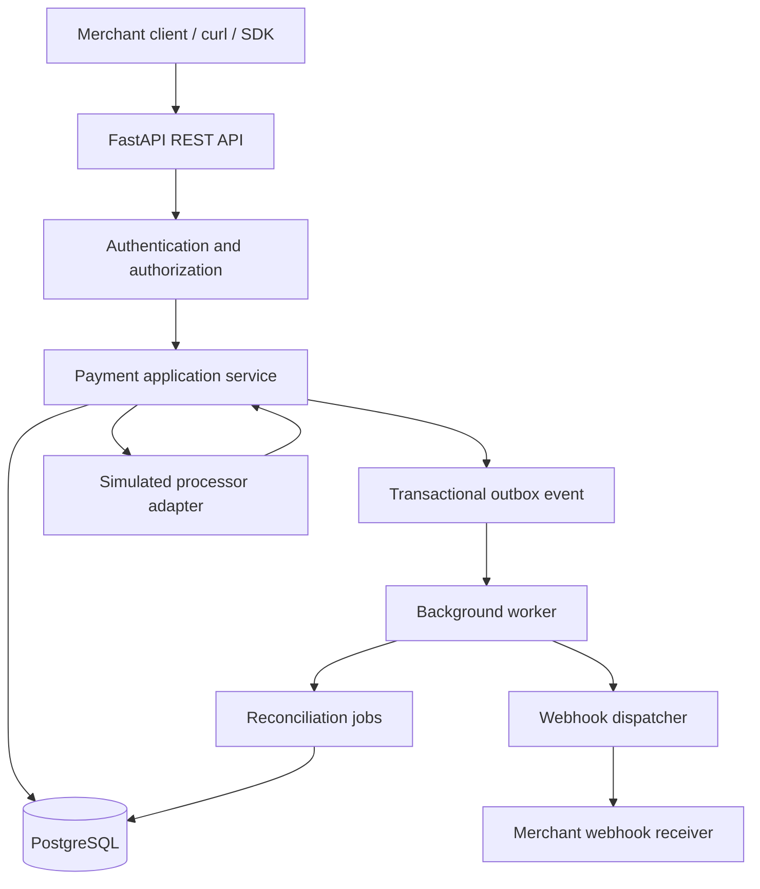

# PayFlow — Payment API Simulator

> **Project blueprint and engineering specification**  
> Version: 1.0 · Status: Planned · Mode: Simulation only

PayFlow is a portfolio-grade backend project that simulates payment processing for online merchants. It exposes a versioned REST API for creating payments, querying payment state, recording refunds, maintaining a double-entry ledger, and delivering signed webhook events. The system is designed to demonstrate backend engineering, database integrity, API design, concurrency control, asynchronous work, security, testing, and operational observability.

**Safety boundary:** PayFlow is an educational simulator. It must not collect real card details, store sensitive authentication data, connect to live payment rails, or represent simulated results as actual money movement. Use synthetic customers, test keys, and deterministic processor responses.

---

## Contents

1. [Goals and scope](#1-goals-and-scope)
2. [User stories](#2-user-stories)
3. [Architecture](#3-architecture)
4. [Technology choices](#4-technology-choices)
5. [Repository layout](#5-repository-layout)
6. [Core modules and responsibilities](#6-core-modules-and-responsibilities)
7. [Payment lifecycle and state transitions](#7-payment-lifecycle-and-state-transitions)
8. [REST API specification](#8-rest-api-specification)
9. [Data model](#9-data-model)
10. [Financial ledger rules](#10-financial-ledger-rules)
11. [Idempotency and concurrency](#11-idempotency-and-concurrency)
12. [Asynchronous processing and transactional outbox](#12-asynchronous-processing-and-transactional-outbox)
13. [Webhook delivery](#13-webhook-delivery)
14. [Security and abuse prevention](#14-security-and-abuse-prevention)
15. [Error handling](#15-error-handling)
16. [Testing strategy](#16-testing-strategy)
17. [Observability and operations](#17-observability-and-operations)
18. [Implementation roadmap](#18-implementation-roadmap)
19. [Acceptance criteria](#19-acceptance-criteria)
20. [Resume and portfolio presentation](#20-resume-and-portfolio-presentation)
21. [First development session](#21-first-development-session)
22. [Reference examples](#22-reference-examples)

---

## 1. Goals and scope

### 1.1 Primary goal

Build a reliable, understandable payment-processing simulation API that behaves predictably under retries, concurrent requests, processor failures, and webhook delivery failures.

### 1.2 Engineering goals

- Design REST endpoints with clear request and response contracts.
- Separate HTTP concerns from business logic and persistence.
- Use PostgreSQL transactions and constraints to protect important invariants.
- Prevent duplicate payment effects with idempotency keys.
- Model payment and refund lifecycles explicitly.
- Record balanced, auditable double-entry ledger journals.
- Use a transactional outbox for durable asynchronous event publication.
- Deliver signed webhooks with bounded retries and attempt history.
- Add integration, failure-path, and concurrency tests.
- Make the project easy for another developer to run locally from the README.

### 1.3 In scope

- Test-mode merchant accounts and API keys.
- Simulated payment authorization/processing outcomes.
- Payment retrieval, filtering, and pagination.
- Full and partial simulated refunds.
- Internal double-entry ledger and transaction history.
- Idempotent create/refund operations.
- Webhook registration, signatures, retries, and delivery logs.
- Docker-based local development, migrations, automated tests, and basic metrics.

### 1.4 Out of scope for the first version

- Real card data, live acquiring, bank integrations, or real money movement.
- Regulatory compliance claims or production payment certification.
- Multiple currencies with FX conversion.
- Real settlement and bank reconciliation.
- Microservices deployed independently.
- Kubernetes, complex event streaming, or a polished merchant dashboard before core correctness is established.

### 1.5 Non-functional priorities

1. **Correctness:** no duplicate financial effect from a retried request; ledger journals balance.
2. **Security:** tenant isolation, secret handling, and safe webhook destinations.
3. **Recoverability:** persisted work survives process restarts.
4. **Clarity:** explicit states, errors, logs, and documentation.
5. **Performance:** measure after correctness; do not claim benchmarks without reproducible tests.

---

## 2. User stories

### Merchant developer

- As a merchant, I can create a simulated payment through an authenticated API.
- As a merchant, I can safely retry a request after a timeout without creating a second payment.
- As a merchant, I can retrieve only my own payments and filter them by status or date.
- As a merchant, I can request a partial or full refund within the refundable amount.
- As a merchant, I can register a webhook endpoint and verify signed event payloads.
- As a merchant, I can inspect a delivery's attempts when my endpoint fails.

### Platform operator

- As an operator, I can inspect request IDs, payment IDs, processor attempts, and webhook delivery failures.
- As an operator, I can identify unresolved processor outcomes and reconcile them safely.
- As an operator, I can run migrations and automated tests in a repeatable environment.

### Engineering invariants

- A merchant cannot access another merchant's resources.
- A single idempotency scope/key cannot create multiple logical operations.
- Reusing a key with a different request body is rejected.
- Posted ledger entries are immutable and every posted journal balances.
- The sum of successful refunds cannot exceed the eligible original payment amount.
- A processor timeout is not automatically interpreted as a decline.
- Webhook delivery is at-least-once; consumers must tolerate duplicate events.

---

## 3. Architecture

### 3.1 Architectural style

Start with a **modular monolith**: one FastAPI application and one PostgreSQL database, divided into modules by business responsibility. Use a separate worker process for asynchronous jobs when the first durable job flow is ready. This keeps deployment and debugging manageable while still allowing you to demonstrate real backend patterns.

Do not split every module into a microservice at the beginning. Extract a service only when there is a clear scaling, ownership, or deployment reason.

### 3.2 High-level component flow



The diagram is conceptual. In the recommended durable design, the request transaction writes the payment and a processing/outbox job, then commits. A worker performs processor simulation outside the database transaction and records the result in a new transaction. This avoids holding database locks while waiting on network operations and allows work to resume after a crash.

### 3.3 Request flow: create payment

1. Client sends `POST /v1/payments` with a test API key and `Idempotency-Key`.
2. Middleware assigns a request ID, authenticates the key, resolves the merchant, and applies rate limits.
3. Pydantic validates the request shape, amount, currency, and allowed fields.
4. The application service canonicalizes the request and computes a request hash.
5. A PostgreSQL transaction claims the idempotency key and creates a payment in `created` or `processing` state, along with a durable processing job/outbox record.
6. The transaction commits. The API returns the payment resource, often with `202 Accepted` if processing is asynchronous.
7. A worker claims the job and calls the deterministic processor simulator outside the transaction.
8. The worker starts a new transaction, records the attempt and outcome, applies valid state transitions, posts balanced ledger entries only for the relevant successful event, and writes event records to the outbox.
9. A webhook worker delivers resulting events and records delivery attempts.
10. The merchant can retrieve the payment and observe its final state.

### 3.4 Why return `202 Accepted`?

If the API persists the request and schedules processing asynchronously, `202 Accepted` communicates that processing has been accepted but may not yet be complete. The response can contain `status: "processing"` and a payment ID. If you later build a fully synchronous simulator, document that contract clearly and use a consistent success response. Do not mix synchronous and asynchronous behavior accidentally.

---

## 4. Technology choices

| Concern | Recommended tool | Reason |
|---|---|---|
| HTTP API | Python + FastAPI | Typed request/response schemas and OpenAPI generation |
| Validation | Pydantic | Explicit input contracts and predictable validation errors |
| Database | PostgreSQL | Transactions, constraints, indexing, and reliable concurrency control |
| ORM | SQLAlchemy 2.x | Database access with explicit transaction boundaries |
| Migrations | Alembic | Versioned schema evolution |
| Worker | A simple PostgreSQL-backed worker initially; Redis-backed queue later if useful | Durable processing without premature infrastructure |
| Tests | pytest + HTTPX | Unit, API, and integration testing |
| Local environment | Docker Compose | Repeatable API/database/worker setup |
| CI | GitHub Actions | Run linting, tests, and migration checks on each change |
| Documentation | OpenAPI + Markdown | Interactive endpoint documentation and clear architecture notes |

**Keep the first implementation small.** PostgreSQL can act as the durable queue/outbox store for an early portfolio version. Add Redis or a dedicated message broker only after you can explain why it is needed and what consistency responsibilities remain in PostgreSQL.

---

## 5. Repository layout

The structure below is a target layout, not a requirement to create every file on day one. Add each module when its behavior is implemented.

```text
payflow/
├── app/
│   ├── main.py                     # FastAPI app construction and router registration
│   ├── config.py                   # Typed environment-based settings
│   ├── api/
│   │   ├── dependencies.py         # DB session, authenticated merchant, request context
│   │   ├── error_handlers.py       # Map application errors to HTTP responses
│   │   └── v1/
│   │       ├── router.py           # Versioned router composition
│   │       ├── payments.py         # Payment HTTP endpoints only
│   │       ├── refunds.py          # Refund HTTP endpoints only
│   │       ├── accounts.py         # Account and ledger read endpoints
│   │       ├── webhooks.py         # Webhook registration and delivery inspection
│   │       └── health.py           # Liveness and readiness checks
│   ├── core/
│   │   ├── security.py             # API key hashing, verification, signatures
│   │   ├── idempotency.py          # Key scope, canonical hash, conflict handling
│   │   ├── exceptions.py           # Domain/application exception types
│   │   ├── logging.py              # Structured logging and redaction helpers
│   │   └── request_context.py      # Request/correlation ID handling
│   ├── merchants/
│   │   ├── models.py               # Merchant and API-key persistence models
│   │   ├── schemas.py              # Public request/response schemas if needed
│   │   ├── repository.py           # Merchant and key queries
│   │   └── service.py              # Merchant/key lifecycle rules
│   ├── payments/
│   │   ├── models.py               # Payment and payment-attempt models
│   │   ├── schemas.py              # Payment API contracts
│   │   ├── repository.py           # Payment persistence queries
│   │   ├── service.py               # Payment use cases and transaction orchestration
│   │   └── state_machine.py         # Allowed transitions and transition validation
│   ├── refunds/
│   │   ├── models.py               # Refund persistence model
│   │   ├── schemas.py               # Refund API contracts
│   │   ├── repository.py            # Refund queries
│   │   └── service.py               # Refund validation and processing
│   ├── ledger/
│   │   ├── models.py                # Accounts, journals, entries
│   │   ├── repository.py            # Ledger read queries
│   │   ├── service.py               # Balanced journal posting and immutability rules
│   │   └── invariants.py            # Balance and reference validation helpers
│   ├── processors/
│   │   ├── base.py                  # Processor adapter protocol/interface
│   │   └── simulator.py             # Deterministic approve/decline/timeout behavior
│   ├── idempotency/
│   │   ├── models.py                # Idempotency records and status
│   │   └── service.py               # Claim, compare, replay and conflict behavior
│   ├── outbox/
│   │   ├── models.py                # Durable events and job status
│   │   ├── repository.py             # Claim and mark events safely
│   │   └── service.py                # Event creation and publishing coordination
│   ├── webhooks/
│   │   ├── models.py                 # Endpoint registrations and delivery attempts
│   │   ├── dispatcher.py             # Delivery scheduling and retry policy
│   │   ├── signing.py                # HMAC signatures and timestamp verification helpers
│   │   └── destination_policy.py     # URL validation and SSRF protections
│   ├── workers/
│   │   ├── payment_worker.py         # Process persisted payment jobs
│   │   ├── webhook_worker.py         # Deliver events and schedule retries
│   │   └── reconciliation_worker.py  # Inspect unresolved processor outcomes
│   └── db/
│       ├── base.py                   # SQLAlchemy declarative base and model imports
│       ├── session.py                # Engine and session factory
│       └── transaction.py            # Shared transaction boundary helpers if needed
├── migrations/                       # Alembic migration revisions
├── tests/
│   ├── unit/                         # Pure business logic and state machine tests
│   ├── api/                          # HTTP contract and authorization tests
│   ├── integration/                  # Real PostgreSQL-backed workflows
│   ├── concurrency/                  # Simultaneous idempotency/refund tests
│   └── factories.py                  # Reusable test fixtures and synthetic data
├── scripts/
│   ├── seed_demo_data.py              # Create synthetic merchants and test keys
│   └── simulate_webhook_receiver.py   # Local receiver for manual testing
├── docs/
│   ├── architecture.md
│   ├── api-examples.md
│   └── decisions/                     # Short architecture decision records
├── Dockerfile
├── docker-compose.yml
├── alembic.ini
├── pyproject.toml
├── .env.example
├── .gitignore
├── Makefile                           # Optional shortcuts for test/lint/migrate
└── README.md
```

### 5.1 Layer responsibilities

- **API routes:** parse HTTP input, call application services, and format HTTP responses. Avoid embedding multi-step business logic in route functions.
- **Schemas:** validate incoming fields and describe outgoing responses. They are not the database models.
- **Services:** enforce business rules and coordinate repository/transaction/processor operations.
- **Repositories:** hold query and persistence logic; avoid hiding transaction boundaries in surprising ways.
- **Models:** define tables, keys, relationships, and database-level constraints.
- **Workers:** execute durable work independently from the original HTTP request.
- **Processor adapter:** isolates simulated processor behavior behind a small interface, making it possible to replace the simulator in tests without changing payment business logic.
- **Tests:** validate business rules at unit level and real database behavior at integration/concurrency level.

### 5.2 Dependency direction

A useful default is `API → application service → domain rules/repositories → database`. The processor adapter is called by the application/worker layer through an interface. Domain logic should not import FastAPI request objects or depend on HTTP status codes.

---

## 6. Core modules and responsibilities

### 6.1 Merchant and API-key management

**Responsibilities**

- Create synthetic merchants for demo use.
- Generate test-mode API keys with a recognizable prefix and sufficient randomness.
- Store a cryptographic hash of the secret, not the full raw key.
- Associate keys with a merchant, status, creation time, and optional permissions.
- Support revocation and rotation.
- Authenticate each request and derive the merchant identity from the validated key, not from an untrusted `merchant_id` in the request body.
- Apply per-merchant rate limits and resource ownership checks.

**Important functions**

- `create_api_key(merchant_id, permissions) -> one_time_secret`
- `authenticate_api_key(raw_key) -> AuthenticatedMerchant`
- `revoke_api_key(key_id, merchant_id) -> None`
- `require_permission(principal, permission) -> None`

Return the secret only at creation time. Never log the raw key. For a small simulator, a keyed hash or an appropriately slow password-hashing strategy can be selected based on the key entropy and threat model; document the choice. High-entropy machine-generated API keys are different from human passwords.

### 6.2 Payment service

**Responsibilities**

- Validate amount and supported currency.
- Create a payment resource with a unique public ID.
- Schedule or execute a simulated processor attempt.
- Enforce legal state transitions.
- Persist processor references, attempt numbers, failure codes, and timestamps.
- Coordinate ledger posting and event creation only when the appropriate outcome is committed.
- Return merchant-scoped payment details.

**Important functions**

- `create_payment(merchant, request, idempotency_key)`
- `get_payment(merchant, payment_id)`
- `list_payments(merchant, filters, cursor, limit)`
- `transition_payment(payment_id, expected_state, new_state, reason)`
- `record_processor_result(attempt_id, result)`

A transition should check the current state and expected state in a transaction. Use a conditional update, row lock, or version column where needed to avoid lost updates.

### 6.3 Processor simulator

Provide a small interface such as `authorize_or_process(request, attempt_id) -> ProcessorResult`. The simulator should support deterministic scenarios controlled by test-only inputs or configured rules, for example:

- Always approve.
- Decline with a stable test failure code.
- Timeout before a result is known.
- Return a result after a configured delay.
- Simulate a transient failure and later success on a new safe attempt.

Avoid random-only behavior in automated tests. Deterministic outcomes make bugs reproducible. Never expose arbitrary simulator controls in a public deployment without authentication and strict test-mode restrictions.

### 6.4 Refund service

**Responsibilities**

- Ensure the payment is in a refundable state.
- Validate positive integer amounts and currency consistency.
- Calculate the remaining refundable amount.
- Serialize concurrent refund requests safely using a row lock, conditional update, or equivalent transaction strategy.
- Create a refund record and a processor-simulation job.
- Post compensating ledger entries only when the refund reaches the state defined by the accounting model.
- Make refund creation idempotent.

**Important functions**

- `create_refund(merchant, payment_id, amount, idempotency_key)`
- `get_refund(merchant, refund_id)`
- `calculate_refundable_amount(payment_id)`
- `complete_refund(refund_id, processor_result)`

The invariant is: `successful_refunds + in_flight_refund_reservations <= eligible_original_amount`, if your design reserves capacity while refunds are processing. Do not calculate the remaining amount using an unlocked read followed by an unprotected insert.

### 6.5 Ledger service

**Responsibilities**

- Create ledger accounts with a defined account type and currency.
- Post journal transactions with at least two entries.
- Validate that debits equal credits for each currency/journal.
- Prevent posting the same business event twice through a unique source reference.
- Prevent mutation/deletion of posted entries through application permissions and database protections where practical.
- Record reversals as new journals.
- Provide read-only account and transaction history.

**Important functions**

- `post_journal(source_type, source_id, entries)`
- `validate_journal_balances(entries)`
- `get_account_history(account_id, cursor, limit)`
- `get_journal_for_source(source_type, source_id)`

Represent money as integer minor units, such as paise for INR. Never use binary floating point for money. Define how currencies with different minor-unit conventions are represented before expanding beyond INR.

### 6.6 Idempotency service

**Responsibilities**

- Scope keys by merchant and operation/endpoint.
- Canonicalize semantically relevant request fields and compute a request hash.
- Atomically claim a new key using a unique database constraint.
- Return the original operation/result for a matching replay.
- Reject reuse with a different payload.
- Represent in-progress requests and define what a concurrent caller receives.
- Apply a documented retention policy without deleting records still needed for safe retries.

**Important functions**

- `canonical_request_hash(payload)`
- `claim_key(merchant_id, operation, key, request_hash)`
- `get_existing_result(scope, key)`
- `complete_key(scope, key, resource_id, response)`

Store a stable response or enough information to reconstruct the documented replay response. Do not blindly replay a stale `processing` response forever if the API contract promises current status; decide whether the idempotent create response is immutable while resource retrieval remains current.

### 6.7 Outbox and worker system

**Responsibilities**

- Store event/job intent in the same transaction as the business change that requires it.
- Claim available jobs without two workers processing the same job concurrently, using a lease/claim model or PostgreSQL locking such as `FOR UPDATE SKIP LOCKED` where appropriate.
- Record attempts, next-run time, completion, and terminal failure.
- Make handlers idempotent because a worker can crash after performing work but before recording completion.
- Recover expired claims after worker crashes.

**Important functions**

- `enqueue_outbox_event(event_type, aggregate_id, payload)`
- `claim_pending_jobs(worker_id, batch_size)`
- `mark_job_succeeded(job_id)`
- `schedule_retry(job_id, next_attempt_at, error_code)`
- `mark_job_dead(job_id, reason)`

### 6.8 Webhook service

**Responsibilities**

- Register merchant-owned endpoints and a signing secret.
- Create delivery jobs for subscribed event types.
- Sign the exact raw request body and include a timestamp.
- Enforce connect/read timeouts and response-size limits.
- Record status code, duration, attempt number, and sanitized error details.
- Retry eligible failures with exponential backoff and jitter.
- Stop after a configured maximum and expose a dead-letter state.
- Protect against server-side request forgery (SSRF): block loopback, link-local, private/internal address ranges where appropriate, validate DNS results, and revalidate on connection to reduce DNS-rebinding risk. In a local demo, allow only explicitly configured test destinations.

### 6.9 Reporting and transaction history

**Responsibilities**

- Filter by payment status, date range, and currency.
- Return stable pagination, preferably cursor-based for growing datasets.
- Ensure every query is scoped to the authenticated merchant.
- Provide summaries from authoritative ledger/payment data rather than independently mutable totals.
- Add indexes based on measured query patterns.

---

## 7. Payment lifecycle and state transitions

Use explicit states and enforce transitions in application logic. A suggested payment state set is:

- `created`: request persisted; no processor result yet.
- `processing`: a processor attempt is in progress.
- `requires_action`: optional state if the simulator models a confirmation step.
- `succeeded`: the simulator returned a successful result and required accounting effects were committed.
- `failed`: a definitive decline/failure was recorded.
- `canceled`: canceled before the operation became irreversible, where allowed.
- `unknown`: optional state for an unresolved processor outcome that needs reconciliation.
- `partially_refunded`: at least one refund succeeded but the eligible amount is not fully refunded.
- `refunded`: the eligible amount has been fully refunded.

### 7.1 Example transition policy

| Current state | Event | Next state | Notes |
|---|---|---|---|
| `created` | Worker claims payment | `processing` | Persist attempt identity |
| `processing` | Definitive approval | `succeeded` | Post the success journal exactly once |
| `processing` | Definitive decline | `failed` | Store stable failure code |
| `processing` | Outcome cannot be determined | `unknown` | Reconcile before unsafe retry |
| `created` | Valid cancellation | `canceled` | Only if no processor action has begun |
| `succeeded` | Partial refund completes | `partially_refunded` | Must remain within refundable amount |
| `succeeded` or `partially_refunded` | Full eligible refund completes | `refunded` | Use compensating ledger journal |

Treat this table as an initial policy to refine. Do not permit arbitrary client-provided status updates. Refund processing may be represented more precisely using a separate refund state machine, while the payment status is derived from the original payment and completed refunds.

### 7.2 Unknown processor outcomes

A timeout is not the same as a decline. The processor may have completed the operation while the caller failed to receive the response. In this state:

1. Mark the attempt as unresolved/unknown.
2. Use the stable processor idempotency/reference key to query or reconcile the outcome if supported by the simulator.
3. Do not issue an unsafe second operation that could duplicate the effect.
4. Resolve the attempt to success or failure only when sufficient evidence exists.
5. Record the reconciliation decision for auditability.

---

## 8. REST API specification

All routes are under `/v1`. Use JSON request/response bodies and HTTPS outside local development. Authenticate with a test-mode API key, for example `Authorization: Bearer sk_test_...`. The example prefix is illustrative; never commit a real secret.

### 8.1 Payments

| Method | Endpoint | Purpose | Typical response |
|---|---|---|---|
| `POST` | `/v1/payments` | Create a simulated payment | `202 Accepted` for async processing, or documented synchronous success |
| `GET` | `/v1/payments/{payment_id}` | Retrieve payment | `200 OK` |
| `GET` | `/v1/payments` | List/filter payments | `200 OK` |
| `POST` | `/v1/payments/{payment_id}/confirm` | Confirm a payment if the state machine requires it | `200 OK` or `409 Conflict` |
| `POST` | `/v1/payments/{payment_id}/cancel` | Cancel an eligible payment | `200 OK` or `409 Conflict` |
| `GET` | `/v1/payments/{payment_id}/events` | Inspect permitted payment event history | `200 OK` |

Suggested create request:

```http
POST /v1/payments HTTP/1.1
Authorization: Bearer sk_test_example
Idempotency-Key: order_784_payment_1
Content-Type: application/json
```

```json
{
  "amount": 49900,
  "currency": "INR",
  "customer_id": "cus_demo_101",
  "description": "Order #784"
}
```

The amount is an integer in minor units: `49900` paise means ₹499.00. `customer_id` is a synthetic ID in this project. Do not accept or store card numbers or CVVs.

Possible async response:

```json
{
  "id": "pay_demo_8f31a2",
  "status": "processing",
  "amount": 49900,
  "currency": "INR",
  "created_at": "2026-10-19T14:30:00Z"
}
```

Use generated IDs that are unique and non-sequential if they are public identifiers. IDs are not authorization: every resource lookup still needs a merchant ownership check.

### 8.2 Refunds

| Method | Endpoint | Purpose |
|---|---|---|
| `POST` | `/v1/payments/{payment_id}/refunds` | Create a full or partial refund |
| `GET` | `/v1/refunds/{refund_id}` | Retrieve refund state |
| `GET` | `/v1/payments/{payment_id}/refunds` | List refunds for a payment |

Example refund body:

```json
{
  "amount": 12000,
  "reason": "customer_request"
}
```

This requests a simulated refund of ₹120.00. Include an idempotency key for refund creation as well. Enforce the total eligible refund amount under concurrency control.

### 8.3 Accounts and ledger

| Method | Endpoint | Purpose |
|---|---|---|
| `GET` | `/v1/accounts/{account_id}` | Retrieve an authorized account summary |
| `GET` | `/v1/accounts/{account_id}/transactions` | List ledger history |

Merchant-facing ledger routes are read-only. Do not expose an endpoint that permits a caller to set an arbitrary balance or write arbitrary ledger entries.

### 8.4 Webhooks

| Method | Endpoint | Purpose |
|---|---|---|
| `POST` | `/v1/webhook-endpoints` | Register a webhook URL and subscribed event types |
| `GET` | `/v1/webhook-endpoints` | List the merchant's registered endpoints |
| `DELETE` | `/v1/webhook-endpoints/{endpoint_id}` | Disable/delete an endpoint according to retention policy |
| `GET` | `/v1/webhook-deliveries/{delivery_id}` | Inspect a delivery and its attempts |
| `POST` | `/v1/webhook-deliveries/{delivery_id}/retry` | Request a controlled retry |

Protect endpoint registration and retries with authentication, authorization, rate limits, and destination validation. Avoid returning signing secrets after their initial creation.

### 8.5 Health endpoints

- `GET /health/live`: process is alive.
- `GET /health/ready`: application can serve requests because required dependencies are available.

Do not expose database credentials, internal network topology, or sensitive dependency details in health responses.

### 8.6 List filters and pagination

Example:

`GET /v1/payments?status=succeeded&limit=25&starting_after=pay_demo_123`

Define a maximum page size, stable ordering, validation for date ranges, and merchant scoping. Cursor pagination is usually more stable than large offset pagination as data grows.

### 8.7 OpenAPI and versioning

- Let FastAPI generate the OpenAPI schema from typed models and route declarations.
- Provide examples for success and failure responses.
- Keep backward-compatible changes within `/v1` when possible.
- Introduce a new major version only when a breaking contract change is required.
- Test the documented contract against actual responses.

---

## 9. Data model

The following describes logical entities. Choose SQL types and constraints deliberately in migrations. Store timestamps in UTC using timezone-aware database types.

### 9.1 `merchants`

| Field | Purpose |
|---|---|
| `id` | Primary key, e.g. UUID |
| `name` | Display name |
| `status` | Active or disabled |
| `created_at` | Creation timestamp |

### 9.2 `api_keys`

| Field | Purpose |
|---|---|
| `id` | Primary key |
| `merchant_id` | Owning merchant FK |
| `key_prefix` | Non-secret prefix for lookup/identification |
| `key_hash` | Hash of the secret used for verification |
| `permissions` | Allowed operations, if permission scopes are implemented |
| `revoked_at` | Nullable revocation timestamp |
| `created_at` | Creation timestamp |

### 9.3 `payments`

| Field | Purpose |
|---|---|
| `id` | Public payment ID |
| `merchant_id` | Owning merchant FK |
| `amount` | Positive integer in minor units |
| `currency` | ISO currency code supported by the simulator |
| `status` | Current state from the state machine |
| `customer_id` | Optional synthetic customer reference |
| `description` | Short merchant-provided description, length-limited |
| `failure_code` | Nullable stable failure code |
| `version` | Optional optimistic-lock version |
| `created_at`, `updated_at` | Audit timestamps |

### 9.4 `payment_attempts`

Fields: `id`, `payment_id`, `attempt_number`, `status`, `processor_reference`, `failure_code`, `started_at`, `finished_at`, `created_at`.

Keep a distinct attempt record for each processor attempt. Do not overwrite prior attempt history when a retry occurs.

### 9.5 `idempotency_records`

Fields: `id`, `merchant_id`, `operation_scope`, `idempotency_key`, `request_hash`, `status`, `resource_id`, `response_status`, `response_body` or response reconstruction data, `created_at`, `expires_at`.

Create a unique constraint on `(merchant_id, operation_scope, idempotency_key)`. Define key length limits and a documented retention policy. Do not expire records while an operation is unresolved or while removing them could permit an unsafe duplicate effect.

### 9.6 Ledger tables

**`accounts`**: `id`, `merchant_id` (nullable for platform-owned accounts), `account_type`, `currency`, `created_at`.

**`ledger_transactions`**: `id`, `source_type`, `source_id`, `status`, `created_at`, `posted_at`.

**`ledger_entries`**: `id`, `ledger_transaction_id`, `account_id`, `direction`, `amount`, `currency`, `created_at`.

Use a unique source reference for business events that must be posted once, such as a successful payment or completed refund. A journal should be constructed and validated as a whole before it is marked posted.

### 9.7 `refunds`

Fields: `id`, `payment_id`, `merchant_id`, `amount`, `currency`, `status`, `reason_code`, `processor_reference`, `idempotency_record_id`, `created_at`, `updated_at`.

### 9.8 Outbox and delivery tables

**`outbox_events`**: `id`, `event_type`, `aggregate_type`, `aggregate_id`, `payload`, `created_at`, `published_at`, `attempt_count`, `next_attempt_at`, `status`.

**`webhook_endpoints`**: `id`, `merchant_id`, `url`, `secret_hash_or_encrypted_secret`, `enabled`, `subscribed_events`, `created_at`.

**`webhook_deliveries`**: `id`, `event_id`, `endpoint_id`, `status`, `attempt_count`, `last_http_status`, `last_error_code`, `next_attempt_at`, `created_at`, `completed_at`.

If you need to sign outgoing events, the worker needs access to the signing secret. Store it encrypted with a documented key-management approach, or derive/store an appropriate keyed secret representation according to the signing design. A one-way hash alone cannot be used to reconstruct an HMAC signing secret.

### 9.9 Indexes and constraints

Start with indexes supporting real queries:

- `payments(merchant_id, created_at, id)`
- `payments(merchant_id, status, created_at)`
- `payment_attempts(payment_id, attempt_number)` with uniqueness
- `refunds(payment_id, status)`
- `ledger_entries(account_id, created_at, id)`
- `outbox_events(status, next_attempt_at, created_at)`
- `webhook_deliveries(endpoint_id, status, next_attempt_at)`

Add foreign keys, positive-amount checks, allowed-status checks where practical, and unique business references. Use `EXPLAIN ANALYZE` against representative data before claiming that an index improves performance.

---

## 10. Financial ledger rules

The ledger is an accounting record, not a cached balance field. A balance may be calculated or cached for performance, but journal entries remain the source of truth.

### 10.1 Example successful payment

For a simplified ₹499 payment, one possible internal journal is:

| Account | Debit | Credit |
|---|---:|---:|
| Processor clearing | ₹499.00 | — |
| Merchant payable | — | ₹499.00 |
| **Total** | **₹499.00** | **₹499.00** |

This is a simplified internal accounting example. It does not mean that PayFlow has moved money through a bank. Fees, reserves, settlement, disputes, and other real-world accounting considerations are intentionally omitted from the first version.

### 10.2 Example refund

A completed refund can be represented by a new compensating journal reversing the relevant payable/clearing effect according to your chosen ledger model. Never delete or edit the original posted payment journal to make the refund appear to have happened.

### 10.3 Ledger invariants

- A posted journal has at least two entries.
- Debits equal credits within each journal and currency.
- Entries use positive integer amounts and an explicit debit/credit direction.
- A journal's business source reference cannot be posted twice.
- Posted journals and entries are immutable through normal application operations.
- Reversals and corrections create new entries with references to the original journal.
- Ledger writes and the corresponding business-state change happen atomically in one database transaction when they are part of the same committed outcome.

A normal SQL `CHECK` constraint cannot sum sibling rows. Validate journal balance in the posting service and transaction; consider a deferred constraint trigger or a database posting procedure for stronger enforcement. Restrict database permissions so application code cannot casually update posted rows.

---

## 11. Idempotency and concurrency

### 11.1 Why idempotency matters

A client can time out after the server has committed a request. The client cannot know whether the operation happened, so it retries. Without idempotency, the retry may create a second logical payment or refund.

### 11.2 Recommended algorithm

1. Require an idempotency key for payment/refund creation.
2. Scope the key to the authenticated merchant and operation.
3. Canonicalize relevant request fields and calculate a stable hash.
4. Attempt to insert the idempotency record under a unique constraint.
5. If the key already exists, compare the hash. If different, return a conflict. If identical, return the saved/defined replay result or current operation reference.
6. In the same database transaction, create the payment/refund and durable job/outbox record.
7. Commit before any external network operation.
8. Use a stable attempt identifier when invoking the processor simulator.
9. Make worker handling safe to repeat; record completion and financial effects atomically.

### 11.3 Pseudocode

```python
def create_payment(merchant_id, idempotency_key, payload):
    request_hash = canonical_hash(payload)

    with db.transaction():
        record = claim_unique_idempotency_key(
            merchant_id=merchant_id,
            operation_scope="POST:/v1/payments",
            key=idempotency_key,
            request_hash=request_hash,
        )

        if record.is_existing:
            if record.request_hash != request_hash:
                raise IdempotencyConflict()
            return replay_or_reference_existing_operation(record)

        payment = insert_payment(
            merchant_id=merchant_id,
            amount=payload.amount,
            currency=payload.currency,
            status="created",
        )
        enqueue_payment_processing(payment.id)
        attach_resource_to_idempotency_record(record, payment.id)

    return payment
```

This is illustrative pseudocode, not a drop-in implementation. The actual algorithm must handle unique-key races, in-progress requests, transaction rollback, and the response contract.

### 11.4 Concurrency controls

- Use unique constraints to enforce uniqueness under concurrent requests.
- Use row locks or conditional updates for payment/refund state transitions where needed.
- Prevent concurrent refund reservations from exceeding the eligible amount.
- Use `SELECT ... FOR UPDATE SKIP LOCKED` or a lease/claim mechanism for workers where appropriate.
- Avoid network calls while holding long database transactions open.
- Test with multiple concurrent clients against PostgreSQL; mocked tests alone are insufficient.

---

## 12. Asynchronous processing and transactional outbox

### 12.1 Why a worker?

Payment simulation, webhook delivery, retry delays, and reconciliation should not depend on the original HTTP request remaining open. Durable asynchronous work also creates an opportunity to learn queue semantics, retries, and crash recovery.

### 12.2 Transactional outbox pattern

When a business transaction needs a follow-up action, store an outbox record in the same database transaction as the state change. A worker later claims and handles the event. This prevents the common failure in which the database commits but the application crashes before publishing the event.

### 12.3 Worker requirements

- Claim a bounded batch of available jobs.
- Record a claim/lease so two workers do not normally handle the same job concurrently.
- Recover jobs whose lease expires after a crash.
- Use bounded timeouts for processor and webhook calls.
- Store attempt count, next-run time, and sanitized failure reason.
- Use exponential backoff with jitter for transient errors.
- Mark permanently failing work as dead-lettered after the configured maximum.
- Make handlers idempotent because a crash can occur after the side effect but before job completion is recorded.

### 12.4 Delivery semantics

Expect **at-least-once** processing, not exactly-once delivery across a network. Exactly-once effects are approximated through stable identifiers, idempotent handlers, database uniqueness, and reconciliation. Document this honestly in the README.

---

## 13. Webhook delivery

### 13.1 Event envelope

```json
{
  "id": "evt_demo_73b91",
  "type": "payment.succeeded",
  "created_at": "2026-10-19T14:30:00Z",
  "data": {
    "payment_id": "pay_demo_8f31a2",
    "amount": 49900,
    "currency": "INR"
  }
}
```

Suggested event types:

- `payment.processing`
- `payment.succeeded`
- `payment.failed`
- `payment.requires_action`
- `refund.processing`
- `refund.succeeded`
- `refund.failed`

Only emit events for state changes that have actually committed. Keep event IDs stable across delivery retries.

### 13.2 Signing

Sign the exact serialized request body using HMAC-SHA256 and a per-endpoint secret. Include a timestamp in the signature scheme, for example a header conceptually like `PayFlow-Signature: t=<unix_timestamp>,v1=<hex_signature>`. The receiver should recompute the signature over the specified timestamp and raw body, use a constant-time comparison, and reject timestamps outside a configured tolerance. The exact signing string and header must be documented and tested.

### 13.3 Retry policy

- Treat connection errors, timeouts, and most `5xx` responses as retryable.
- Treat most other `4xx` responses as permanent unless your documented policy says otherwise.
- Use exponential backoff with jitter.
- Set a maximum attempt count and dead-letter state.
- Store response status, attempt number, duration, and a sanitized error code.
- Provide a controlled manual retry operation for authorized users.

### 13.4 Local testing

Build a tiny local webhook receiver that can return configurable `200`, `500`, delayed responses, or connection failures. This makes retry and signature behavior easy to demonstrate in a screen recording or README walkthrough.

---

## 14. Security and abuse prevention

This is a portfolio project, but implement sensible security from the start.

- Use only synthetic test data and test-mode keys.
- Never accept real card numbers or CVVs.
- Hash API keys at rest; redact secrets from logs.
- Use environment variables for local secrets and provide only placeholders in `.env.example`.
- Enforce merchant ownership on every resource lookup and mutation.
- Validate all request fields and cap body size, string length, page size, and date-range width.
- Apply rate limits to authentication, payment creation, webhook registration, and manual retry endpoints.
- Use parameterized database queries/ORM expressions.
- Keep CORS restrictive if a browser client is added.
- Use HTTPS outside local development.
- Restrict webhook destinations to reduce SSRF risk; block internal/private destinations unless a specific local test allowlist is configured.
- Set outbound connection and response timeouts for webhooks.
- Avoid logging request bodies by default; redact identifiers or descriptions if they can contain sensitive information.
- Keep dependency versions controlled and run automated dependency/security checks where practical.
- Return generic authorization errors where revealing resource existence would leak information.

Do not describe the project as PCI-compliant or production-ready. It is a learning simulator.

---

## 15. Error handling

Use one consistent error envelope:

```json
{
  "error": {
    "code": "invalid_amount",
    "message": "Amount must be a positive integer.",
    "request_id": "req_demo_a813"
  }
}
```

Suggested mapping:

| HTTP status | Use |
|---|---|
| `400 Bad Request` | Malformed JSON or invalid request semantics |
| `401 Unauthorized` | Missing or invalid credentials |
| `403 Forbidden` | Authenticated caller lacks permission |
| `404 Not Found` | Resource not available within the caller's permitted scope |
| `409 Conflict` | Incompatible idempotency reuse or invalid state transition |
| `422 Unprocessable Entity` | Schema/field validation failure if this is the documented policy |
| `429 Too Many Requests` | Rate limit exceeded |
| `500 Internal Server Error` | Unexpected internal failure; do not leak stack traces |
| `503 Service Unavailable` | Temporary dependency or service unavailability where appropriate |

Choose a consistent validation policy between `400` and `422`. Return stable machine-readable error codes, but keep internal exception details and secrets out of public responses.

---

## 16. Testing strategy

### 16.1 Unit tests

Test pure business rules without a database:

- Valid and invalid payment state transitions.
- Currency/amount validation.
- Canonical request hashing.
- Ledger journal balance validation.
- Refund amount calculation.
- HMAC signature generation and verification.
- Retry delay calculation.

### 16.2 API tests

Test HTTP contracts and authorization:

- Missing/invalid/revoked API key.
- Valid payment creation and retrieval.
- Invalid payload and standard error envelope.
- Pagination and filtering.
- Merchant A cannot access Merchant B's resources.
- Unsupported methods and unknown routes behave predictably.

### 16.3 Integration tests

Run against a real PostgreSQL test database:

- Migrations create the expected schema.
- Payment and outbox record commit atomically.
- Processor success creates exactly one success journal.
- Processor decline does not create a success journal.
- Refund completion posts a balanced compensating journal.
- Posted ledger entries cannot be modified through normal services.
- Worker restarts recover pending or expired-lease jobs.

### 16.4 Concurrency tests

Use simultaneous independent requests/sessions:

- Ten identical payment requests with one idempotency key produce one logical payment.
- Same key with different payloads yields a conflict.
- Two refunds cannot exceed the refundable amount in total.
- Multiple workers do not permanently lose jobs or create duplicate financial effects.

### 16.5 Failure-injection tests

Simulate:

- Processor timeout before outcome is known.
- Worker crash after processor response but before completion update.
- Webhook receiver returns `500` or times out.
- Database disconnect while an operation is in progress.
- Duplicate event delivery.
- Invalid webhook signature and stale timestamp.

For every test, assert both the returned API behavior and the persisted state. Correct HTTP responses are not enough if the database is inconsistent.

---

## 17. Observability and operations

### 17.1 Structured logs

Include useful correlation fields such as `request_id`, `merchant_id`, `payment_id`, `attempt_id`, `event_id`, and `worker_id` where applicable. Never log API secrets, webhook signing secrets, or raw sensitive payment information.

### 17.2 Metrics

Potential metrics include:

- Request count and error count by route/status.
- Request latency percentiles (p50, p95, p99).
- Payment processing success/decline/unknown counts.
- Processor simulation latency.
- Idempotency replay and conflict counts.
- Outbox backlog and oldest pending event age.
- Webhook success rate, retries, and dead-letter count.
- Database connection pool usage.

Define labels carefully; avoid unbounded-cardinality labels such as raw payment IDs.

### 17.3 Health checks

- Liveness: the process is running.
- Readiness: the service can reach essential dependencies and is able to accept work.

Do not run expensive full reconciliation logic on every readiness request.

### 17.4 Reconciliation

A periodic reconciliation job should find payments/attempts that remain unresolved too long, jobs whose leases expired, and mismatches between successful payment/refund states and ledger source references. It should report discrepancies and apply only safe, well-defined recovery actions. Preserve an audit trail for any automated repair.

---

## 18. Implementation roadmap

### Milestone 1 — Working API foundation

**Build:** project configuration, FastAPI app, PostgreSQL, SQLAlchemy, Alembic, payment model, create/get endpoints, schema validation, and basic tests.

**Acceptance:** a developer can start the app locally, migrate the database, create a simulated payment, retrieve it, and run tests.

### Milestone 2 — State machine and idempotency

**Build:** payment state transition rules, idempotency table, request canonicalization, unique constraints, and deterministic processor simulator.

**Acceptance:** same-key retries do not create duplicate logical payments; conflicting payloads are rejected; invalid transitions fail safely.

### Milestone 3 — Ledger correctness

**Build:** accounts, journals, entries, atomic posting, unique source references, and account history.

**Acceptance:** successful payment journals balance; declines do not post success journals; duplicate worker handling cannot post the same journal twice.

### Milestone 4 — Refunds

**Build:** refund state machine, partial/full refunds, idempotency, refund amount reservation, and compensating journals.

**Acceptance:** concurrent refunds cannot exceed the eligible amount; refunds are auditable and idempotent.

### Milestone 5 — Outbox and webhooks

**Build:** outbox event table, worker claims/leases, signed webhooks, retry policy, delivery history, and local receiver.

**Acceptance:** events survive process restarts; delivery failures are retried; duplicate deliveries are identifiable and safe to consume.

### Milestone 6 — Security, observability, deployment

**Build:** API-key management, merchant isolation tests, rate limiting, structured logs, health endpoints, Docker Compose, CI, and README diagrams.

**Acceptance:** a clean clone can be run from documented steps; tests run automatically; secrets are not committed; no cross-merchant access is possible in the test suite.

### Suggested schedule

| Work block | Focus |
|---|---|
| Sessions 1–2 | App, database, migrations, payment create/get |
| Sessions 3–4 | State machine, simulator, idempotency |
| Sessions 5–6 | Ledger and ledger tests |
| Sessions 7–8 | Refunds and concurrency controls |
| Sessions 9–10 | Outbox, worker and webhook delivery |
| Sessions 11–12 | Security, CI, observability, documentation |

This is a planning estimate, not a guarantee. Spend additional time where tests reveal correctness problems rather than rushing to the next feature.

---

## 19. Acceptance criteria

The project is ready for a strong portfolio demonstration when all of the following are true:

- [ ] A clean clone can be configured using `.env.example` and documented commands.
- [ ] Database schema is managed by migrations, not manual undocumented changes.
- [ ] Payment endpoints use validated request/response schemas.
- [ ] API keys are hashed and revocable.
- [ ] Every resource access is merchant-scoped.
- [ ] Payment state transitions are explicit and tested.
- [ ] Idempotency is enforced by database uniqueness and tested under concurrency.
- [ ] Processor timeouts are handled as potentially uncertain outcomes.
- [ ] Ledger journals balance and posted entries are immutable through normal application paths.
- [ ] Full and partial refunds are bounded and idempotent.
- [ ] Outbox events survive process restarts.
- [ ] Webhooks are signed, retried, and recorded with attempt history.
- [ ] Unit, integration, API, concurrency, and failure-path tests exist.
- [ ] Logs are structured and do not expose secrets.
- [ ] OpenAPI documentation and useful curl examples are included.
- [ ] README states the limitations of the simulation and does not claim real-money processing or compliance.

---

## 20. Resume and portfolio presentation

### 20.1 Resume bullet template

Use only after the features are implemented and verified:

> Built a simulated payment processing API using FastAPI and PostgreSQL, implementing idempotent payment creation, transactional ledger posting, refund validation, and retryable webhook delivery; validated correctness with integration and concurrent-request tests.

Improve the bullet with measured outcomes only after running reproducible benchmarks. For example, report request throughput or p95 latency with the test environment, dataset, concurrency, and command documented.

### 20.2 README sections

1. Project summary and simulation-only disclaimer.
2. Problem statement and core features.
3. Architecture diagram.
4. Technology stack and design decisions.
5. Quick start and environment configuration.
6. Database migrations and synthetic seed data.
7. API endpoint reference and example requests.
8. Payment state machine.
9. Idempotency and concurrency design.
10. Ledger model and invariants.
11. Outbox/webhook retry semantics.
12. Testing commands and failure scenarios.
13. Benchmarks with reproducible methodology, if available.
14. Known limitations and future improvements.

### 20.3 Good future enhancements

After core correctness is proven, consider:

- Merchant dashboard for payment and webhook inspection.
- A small Python SDK generated from or aligned with the OpenAPI contract.
- API usage metering and quotas.
- A C++ processor simulator or reverse proxy to connect the project to systems programming.
- PostgreSQL query-plan analysis and a reproducible load-test harness.
- A message broker adapter to compare database polling with queue-based delivery.
- A reconciliation report and dead-letter reprocessing CLI.

Avoid adding features simply to inflate the tech stack. Each enhancement should have a measurable purpose and tests.

---

## 21. First development session

### Objective

Create the repository, run the API and PostgreSQL locally, migrate the database, and implement the first tested `POST /v1/payments` endpoint. Keep the first version synchronous only if that makes the learning step clearer; design the persistence/service boundary so durable async processing can be introduced next.

### Checklist

- [ ] Create the Git repository and Python virtual environment.
- [ ] Add FastAPI, Uvicorn, Pydantic Settings, SQLAlchemy, Alembic, a PostgreSQL driver, HTTPX, and pytest.
- [ ] Run PostgreSQL with Docker Compose.
- [ ] Add configuration loading from environment variables.
- [ ] Create a SQLAlchemy engine/session factory.
- [ ] Define the `Payment` model with amount, currency, status, merchant ID, and timestamps.
- [ ] Generate and apply the first Alembic migration.
- [ ] Implement `POST /v1/payments` with validation.
- [ ] Implement `GET /v1/payments/{payment_id}` with merchant scoping, even if the first local test uses a seeded demo merchant.
- [ ] Write tests for a valid request, zero/negative amount, missing fields, and retrieval of an unknown payment.
- [ ] Add setup instructions and commit the working implementation.

### Recommended first commands

Create a virtual environment and install your chosen dependencies according to the current versions you select. Keep exact dependency pins in `pyproject.toml` or a lock file after verifying the environment. Then run the app and database using documented Compose commands, apply migrations, and execute tests.

Do not put real credentials in source control. `.env.example` should contain placeholders only.

---

## 22. Reference examples

### 22.1 Example payment object

```json
{
  "id": "pay_demo_8f31a2",
  "merchant_id": "mer_demo_101",
  "amount": 49900,
  "currency": "INR",
  "status": "succeeded",
  "description": "Order #784",
  "created_at": "2026-10-19T14:30:00Z",
  "updated_at": "2026-10-19T14:30:02Z"
}
```

In public API responses, consider omitting internal `merchant_id` if it adds no value to the caller. The sample illustrates the stored resource shape, not a mandatory public response.

### 22.2 Example error object

```json
{
  "error": {
    "code": "idempotency_key_reused",
    "message": "This idempotency key was previously used with a different request.",
    "request_id": "req_demo_a813"
  }
}
```

### 22.3 Useful local test scenarios

1. Create a payment with an approval scenario and verify its final state.
2. Create a payment with a decline scenario and inspect the attempt record.
3. Retry the same create request with the same key and body.
4. Reuse that key with a different amount and verify a conflict.
5. Send concurrent duplicate requests and inspect payment count.
6. Complete a partial refund and inspect the compensating journal.
7. Force a webhook receiver to return `500`, then verify retry scheduling.
8. Stop and restart a worker with pending work and verify recovery.
9. Attempt to fetch another merchant's payment and verify access denial.
10. Run the full test suite from a clean database after applying migrations.

---

## Final engineering principle

Build PayFlow in this order: **correct data model → clear API contract → safe state transitions → idempotency → ledger integrity → durable background work → webhook delivery → security and observability → measured performance**.

A small implementation with rigorous tests and a clear explanation of failure modes is more valuable than a large collection of unfinished endpoints. Keep the project simulation-only, document trade-offs honestly, and use each milestone to demonstrate a specific engineering capability.
