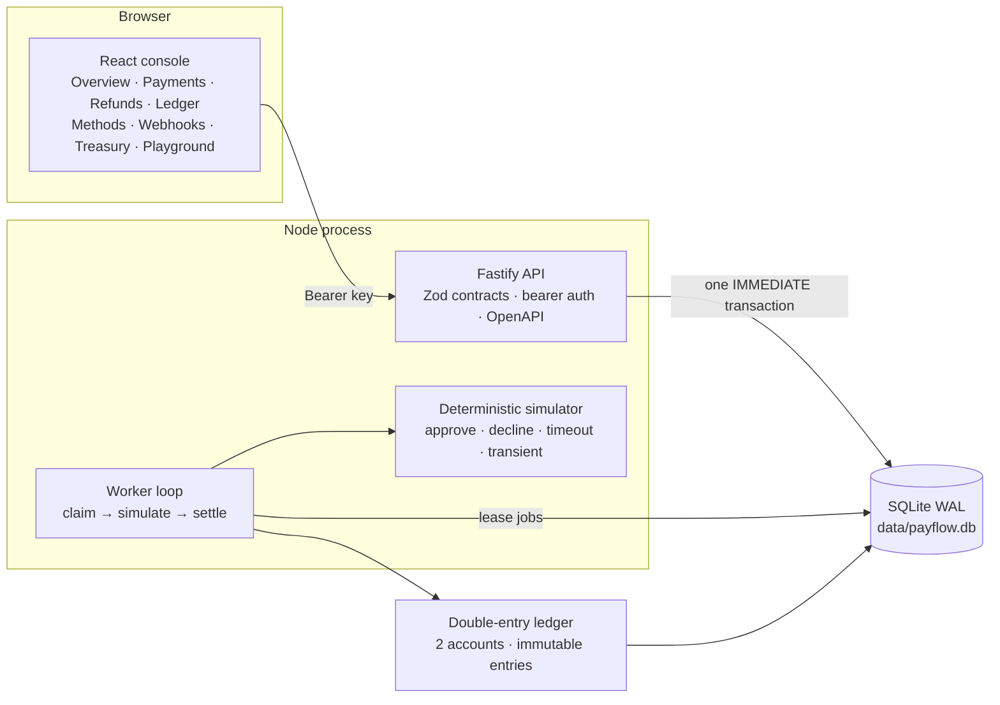
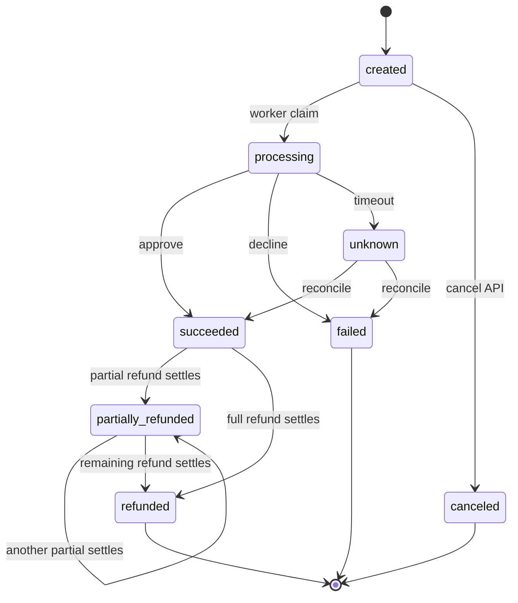
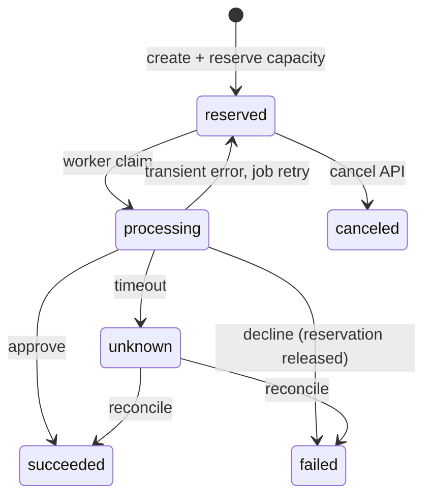

# PayFlow

A payment-processing simulator implementing the mechanics of a production
payment system: idempotent writes, a guarded state machine, durable background
processing, bounded refunds, and a double-entry ledger, with a React operations
console.

|                   |                                                                                                               |
| ----------------- | ------------------------------------------------------------------------------------------------------------- |
| **Stack**         | TypeScript · Fastify 5 · Zod 4 · Drizzle ORM · SQLite (WAL) · React 19 · Vite 7 · Tailwind 4 · TanStack Query |
| **Runtime**       | One Node process (API and worker), one SQLite file, no external services                                      |
| **Tests**         | 44 API tests, CI-gated through `npm run verify`                                                               |
| **Documentation** | This file is the reference; [`DEEP_DIVE.md`](./DEEP_DIVE.md) explains the concepts behind it                  |

> **Simulation only.** No card data is accepted, no processor is contacted, and no
> money moves. All amounts are integer paise held in a local SQLite database.

Included: API-key authentication with merchant-scoped access; idempotent payment
and refund creation; tokenized payment methods; explicit state machines; a
durable job queue with leases, backoff and dead letters; a deterministic
processor simulator; transactional webhook delivery with signed payloads and
retry; payouts bounded by the merchant balance; disputes with ledger impact;
API-key management; cursor pagination; a uniform error envelope; request
identifiers; payment and settlement reports; and an operations console.

Excluded by design: real card data and PCI scope, real processors, webhooks
signed to third-party infrastructure, message brokers, PostgreSQL,
multi-currency, fees, scheduled payouts, subscriptions, invoices, chargeback
evidence review, and user accounts.

---

## 1. Design decisions

| Area               | Decision                                            | Rejected                            | Rationale                                                                                                 |
| ------------------ | --------------------------------------------------- | ----------------------------------- | --------------------------------------------------------------------------------------------------------- |
| Write semantics    | `202 Accepted` with polling                         | `200` with a non-final body         | The processor has not been called; a final-looking response invites clients to act on unsettled payments. |
| Idempotency        | Client key, body fingerprint, stored response       | Server-side deduplication by amount | Only the client can determine that two requests express one intent.                                       |
| Key lifetime       | 24-hour TTL, then reusable                          | Permanent replay                    | A key is a retry token, not a durable lock.                                                               |
| Uncertain outcomes | `unknown` state with reconciliation                 | Treating a timeout as a failure     | A timeout may be a capture; failing it silently loses money.                                              |
| Concurrency        | One atomic conditional `UPDATE`                     | Read-then-write, row locks          | No check/write window, and the pattern ports to PostgreSQL unchanged.                                     |
| Storage            | SQLite in WAL mode                                  | PostgreSQL                          | Real transactions, constraints and triggers with no infrastructure to operate.                            |
| Queuing            | A `jobs` table with leases                          | Redis or a broker                   | Leases, backoff and dead letters without a second service.                                                |
| Job delivery       | At-least-once with idempotent handlers              | Exactly-once                        | Exactly-once delivery is not achievable; idempotency is.                                                  |
| Money              | Integer minor units                                 | Floating point, decimals            | Exact arithmetic and straightforward auditing.                                                            |
| Accounting         | Derived balances, immutable journals                | Stored balances, mutable entries    | Stored balances drift; immutable entries cannot be rewritten.                                             |
| Tenancy            | `404` for another merchant's resource               | `403`                               | `403` discloses that the resource exists.                                                                 |
| Authentication     | HMAC with a server-side pepper, timing-safe compare | Plain SHA-256 of the key            | The pepper defeats offline cracking; the compare defeats timing leaks.                                    |
| Deliveries         | Transactional outbox, signed payloads, retry        | Fire-and-forget callbacks           | The event is written with the business change, so a delivery can never be lost.                           |
| Instruments        | Tokenized methods, no PAN ever stored               | Storing card numbers                | Only display metadata is kept, so there is no secret to leak.                                             |
| Payouts            | Bounded by the merchant payable balance             | Unrestricted transfers              | A payout can never move money the merchant has not collected.                                             |
| Disputes           | An overlay that posts its own journal               | A payment status                    | The charge is still settled; the dispute is a separate, reversible fact.                                  |
| Keys               | Hashed, revocable, individually issued              | One long-lived key                  | Leaks are contained and rotation does not need a redeploy.                                                |

---

## 2. Architecture



```text
POST /v1/payments
  1. authenticate   bearer key → HMAC lookup → merchant context
  2. validate      Zod: integer amount_minor > 0, currency = INR
  3. commit        BEGIN IMMEDIATE → payment + event + job + idempotency record
  4. respond       202 { status: "created" }, Location header
  5. process       worker claims job → records attempt → calls the simulator
                   approve → succeeded + journal       decline → failed
                   error   → retry with backoff         timeout → unknown + reconcile
```

Routes never execute SQL directly. Services own the business rules, and the
worker reuses the same service functions, so each rule has one implementation.

---

## 3. Quick start

Node 22 or newer is required. No database server or container is required.

```bash
npm install
npm run seed     # merchants, 14 days of demo history, data/demo-key.json
npm run dev      # API on :4000, console on :5173
```

| Surface           | URL                                       |
| ----------------- | ----------------------------------------- |
| Console           | http://localhost:5173                     |
| API               | http://localhost:4000                     |
| OpenAPI UI / JSON | http://localhost:4000/docs · `/docs/json` |
| Health            | http://localhost:4000/health              |

**Authentication.** The console offers a demo sign-in, which reads the seeded key
through the development-only `GET /v1/demo/session`, or accepts a pasted API
key. The key is written to `data/demo-key.json` with mode `0600` and is printed
once by the seed script.

**Webhook loop.** The seed registers `http://127.0.0.1:4000/_sink/demo` as a
webhook endpoint. The development sink records what it receives and can be
inspected at `GET /_sink/demo` or from the console's webhooks page, so the
whole delivery path is visible without an external service.

```bash
KEY=$(node -e "console.log(JSON.parse(require('fs').readFileSync('data/demo-key.json','utf8')).api_key)")

curl -s -X POST http://localhost:4000/v1/payments \
  -H "Authorization: Bearer $KEY" \
  -H "Idempotency-Key: order_1042_attempt_1" \
  -H "Content-Type: application/json" \
  -d '{"amount_minor":24900,"currency":"INR","customer_id":"cus_demo_101","description":"Order #1042","simulator_scenario":"approve"}'
```

---

## 4. Core concepts

**Money.** Amounts are integers in paise; `amount_minor` is authoritative and
`amount` is derived for display. `refundable_minor = amount_minor −
refunded_minor − refund_reserved_minor`. All arithmetic is integer, and rounding
occurs only at the serialization boundary.

**Payment states.**



`failed`, `canceled` and `refunded` are terminal; `unknown` is unresolved and
may still become `succeeded` or `failed`. Any other transition is rejected with
`409 invalid_state_transition`, and every transition writes a
`payment_events` row that serves as the timeline and the audit trail.

**Refund states.**



Only `succeeded` and `partially_refunded` payments are refundable, and omitting
`amount_minor` refunds the entire remaining balance.

**Idempotency.** Keys are scoped to `(merchant_id, operation, idempotency_key)`
and the body is fingerprinted with `sha256`. The record, the business write and
the stored response commit in one transaction, so a replay returns the original
response body. A different body yields `409 idempotency_key_reused`, a request
still in flight yields `409 idempotency_in_progress`, and a key past its TTL
starts a new operation.

**Capacity reservation.** One atomic conditional update holds refund capacity,
so concurrent refunds cannot consume the same headroom:

```sql
UPDATE payments
SET refund_reserved_minor = refund_reserved_minor + :amount
WHERE id = :id
  AND status IN ('succeeded','partially_refunded')
  AND refunded_minor + refund_reserved_minor + :amount <= amount_minor;
```

A result of `changes !== 1` yields `409 refund_exceeds_remaining`. Declined and
canceled refunds release their reservation.

**Durable jobs.** `process_payment`, `process_refund`, `process_payout`,
`reconcile_payment`, `reconcile_refund`, `reconcile_payout` and
`deliver_webhooks` are claimed by a conditional update, leased for 60 seconds,
and retried with `min(300, 2^attempts × 2)` seconds of backoff until the retry
budget is exhausted and the job becomes `dead`. Expired leases return work to
the queue, so a crashed worker loses nothing. Delivery is at-least-once, and
handlers are therefore idempotent.

**Payment methods.** Instruments are tokenized: a method stores a type
(`card`, `upi`, `bank`, `wallet`), a label, and display metadata such as the
last four digits. No card number is ever accepted, so there is no secret to
leak. A method may be attached to a payment, and a disabled method is refused
with `409 payment_method_not_active`. The instrument also changes the
simulator's behaviour: `auto` outcomes are drawn from a per-type distribution,
so a UPI payment behaves differently from a bank transfer.

**Reconciliation.** A timeout is never recorded as a failure. The payment moves
to `unknown`, a reconciliation job is scheduled approximately five seconds
later, and `lookup()` resolves the outcome against the stored processor
reference. The simulator is deterministic, so the same reference always
resolves identically.

**Webhooks.** Events are written to an outbox table in the same transaction as
the business change, and a `deliver_webhooks` job delivers them afterwards. The
event cannot be lost, and it cannot be delivered before the change it
describes is committed. Payloads are signed with
`X-PayFlow-Signature: t=<unix>,v1=<hmac-sha256(secret, "<t>.<body>")>`, and
each attempt is recorded with its response status. A failing endpoint is
retried with the job's backoff and eventually dead-lettered; endpoints that
already succeeded are not delivered to twice.

**Payouts.** A payout moves money out of the merchant payable balance. The
amount is checked against that balance inside the transaction, so a payout can
never move money the merchant has not collected; an excessive payout is
rejected with `409 insufficient_balance`. A successful payout debits
`merchant_payable` and credits `processor_clearing`, extinguishing the
merchant's claim. Timeouts become `unknown` and are reconciled.

**Disputes.** A dispute is an overlay on a settled payment, not a payment
status. It is opened against a `succeeded` or `partially_refunded` payment and
resolved as `won` or `lost`. A lost dispute debits `merchant_payable` and
credits `processor_clearing`; a won dispute posts nothing. The charge itself
remains settled, which keeps the history truthful.

**Ledger.** A successful payment debits `processor_clearing` and credits
`merchant_payable`; a refund, a payout, and a lost dispute reverse or reduce
that position. Balances are derived, never stored. One journal is posted per
business event, enforced by `UNIQUE (source_type, source_id)`, and SQLite
triggers reject `UPDATE` and `DELETE` on ledger entries and `DELETE` on posted
journals, so immutability is enforced rather than asserted. Failed payments,
failed refunds, and failed payouts post no journal.

---

## 5. API

Base URL `http://localhost:4000`. Requests require
`Authorization: Bearer sk_test_…`; writes require `Content-Type: application/json`.

**Conventions.** Every operation carries a stable `operationId`, so generated
SDKs expose named methods. Every response carries `x-request-id` and
`x-payflow-api-version`; rate limit headers (`x-ratelimit-limit`,
`x-ratelimit-remaining`, `x-ratelimit-reset`) are exposed. `GET /v1` returns a
machine-readable description of the deployment — resources, simulator
scenarios, outcome distributions, webhook event types, error codes, and limits
— which is the recommended starting point for a client or a code generator.

| Method | Path                                | Auth | Purpose                                             |
| ------ | ----------------------------------- | ---- | --------------------------------------------------- |
| `GET`  | `/health`                           | No   | Liveness, database check, worker state, queue depth |
| `GET`  | `/v1/demo/session`                  | No   | Seeded demo key (development only)                  |
| `GET`  | `/v1`                               | Yes  | Deployment capabilities, limits, and vocabularies   |
| `GET`  | `/v1/merchants/me`                  | Yes  | Current merchant and environment                    |
| `POST` | `/v1/payments`                      | Yes  | Create a payment; `202`                             |
| `GET`  | `/v1/payments`                      | Yes  | List payments; `status` filter, cursor pagination   |
| `GET`  | `/v1/payments/:id`                  | Yes  | Payment with attempts and events                    |
| `POST` | `/v1/payments/:id/cancel`           | Yes  | Cancel a `created` payment                          |
| `GET`  | `/v1/payments/:id/refunds`          | Yes  | Refunds of one payment, paginated                   |
| `POST` | `/v1/refunds`                       | Yes  | Create a refund; `202`                              |
| `GET`  | `/v1/refunds`                       | Yes  | List refunds; `status` and `payment_id` filters     |
| `GET`  | `/v1/refunds/:id`                   | Yes  | One refund                                          |
| `POST` | `/v1/refunds/:id/cancel`            | Yes  | Cancel a reserved refund and release its capacity   |
| `GET`  | `/v1/accounts`                      | Yes  | Accounts and trial balance                          |
| `GET`  | `/v1/ledger/journals`               | Yes  | Posted journals, paginated                          |
| `GET`  | `/v1/stats/overview`                | Yes  | Dashboard aggregates                                |
| `GET`  | `/v1/stats/timeseries`              | Yes  | Daily volume, zero-filled                           |
| `POST` | `/v1/payment_methods`               | Yes  | Register a tokenized instrument; `201`              |
| `GET`  | `/v1/payment_methods`               | Yes  | List instruments; `status` filter                   |
| `GET`  | `/v1/payment_methods/:id`           | Yes  | One instrument                                      |
| `POST` | `/v1/payment_methods/:id/disable`   | Yes  | Disable an instrument                               |
| `POST` | `/v1/payouts`                       | Yes  | Create a payout; `202`                              |
| `GET`  | `/v1/payouts`                       | Yes  | List payouts; `status` filter                       |
| `GET`  | `/v1/payouts/:id`                   | Yes  | One payout                                          |
| `POST` | `/v1/disputes`                      | Yes  | Open a dispute; `201`                               |
| `GET`  | `/v1/disputes`                      | Yes  | List disputes; `status` filter                      |
| `GET`  | `/v1/disputes/:id`                  | Yes  | One dispute                                         |
| `POST` | `/v1/disputes/:id/resolve`          | Yes  | Resolve as `won` or `lost`                          |
| `POST` | `/v1/webhook_endpoints`             | Yes  | Register an endpoint; the secret is returned once   |
| `GET`  | `/v1/webhook_endpoints`             | Yes  | List endpoints                                      |
| `POST` | `/v1/webhook_endpoints/:id/disable` | Yes  | Disable an endpoint                                 |
| `GET`  | `/v1/webhook_events`                | Yes  | Outbox events; `status` filter                      |
| `GET`  | `/v1/webhook_events/:id`            | Yes  | One event with its payload                          |
| `GET`  | `/v1/webhook_deliveries`            | Yes  | Delivery attempts                                   |
| `POST` | `/v1/api_keys`                      | Yes  | Issue a key; the secret is returned once            |
| `GET`  | `/v1/api_keys`                      | Yes  | List keys, prefixes, and last use                   |
| `POST` | `/v1/api_keys/:id/revoke`           | Yes  | Revoke a key                                        |
| `GET`  | `/v1/reports/payments`              | Yes  | Payment report for a window; `format=csv` exports   |
| `GET`  | `/v1/reports/settlement`            | Yes  | Settlement summary for one day                      |
| `GET`  | `/docs`, `/docs/json`               | No   | OpenAPI 3.1 document and UI                         |
| `POST` | `/_sink/:token`                     | No   | Development webhook sink (development only)         |
| `GET`  | `/_sink/:token`                     | No   | Inspect what the sink received (development only)   |

**Simulator scenarios.** Selected with `simulator_scenario` in the body or the
`X-Simulator-Scenario` header; the body takes precedence and `auto` is the
default. Any scenario other than `auto` is rejected when
`PAYFLOW_ALLOW_SIMULATOR_CONTROLS` is false.

| Scenario    | Behaviour                        | Result                                                                                                        |
| ----------- | -------------------------------- | ------------------------------------------------------------------------------------------------------------- |
| `approve`   | Always approves                  | `succeeded`, journal posted                                                                                   |
| `decline`   | Always declines                  | `failed`, `card_declined`, no journal                                                                         |
| `timeout`   | No answer returned               | `unknown`, then reconciled after approximately five seconds                                                   |
| `transient` | First attempt errors             | Retry succeeds; two attempts recorded                                                                         |
| `auto`      | `sha256(reference + type) % 100` | Per-instrument distribution: card 78/16/6, upi 92/5/3, bank 68/22/10, wallet 84/11/5 (success/lookup/timeout) |

**Pagination.** Keyset pagination is used rather than offsets. The cursor
encodes `created_at|id` and orders by `created_at DESC, id DESC`, so pages
remain stable while rows are inserted. Responses contain `data`, `has_more` and
`next_cursor`; `limit` accepts `1 … PAYFLOW_MAX_PAGE_SIZE` and defaults to
`PAYFLOW_DEFAULT_PAGE_SIZE`. Every list endpoint filters on the status
vocabulary of its own resource: payment statuses for payments, refund statuses
for refunds, payout statuses for payouts, dispute statuses for disputes, and
delivery states for webhook events.

**Errors.** All failures use one envelope, and `request_id` is also returned in
the `x-request-id` response header. Validation failures add a `details` array.

```json
{
  "error": {
    "code": "idempotency_key_reused",
    "message": "This idempotency key was already used with a different request body.",
    "request_id": "req_..."
  }
}
```

| Status | Codes                                                                                                                                                                                    |
| ------ | ---------------------------------------------------------------------------------------------------------------------------------------------------------------------------------------- |
| `400`  | `validation_error`, `invalid_request`, `invalid_cursor`, `unsupported_currency`, `invalid_scenario`                                                                                      |
| `401`  | `unauthorized`                                                                                                                                                                           |
| `403`  | `simulator_controls_disabled`                                                                                                                                                            |
| `404`  | `not_found`                                                                                                                                                                              |
| `409`  | `idempotency_key_reused`, `idempotency_in_progress`, `refund_exceeds_remaining`, `payment_not_refundable`, `refund_not_cancelable`, `payment_not_cancelable`, `invalid_state_transition` |
| `429`  | Rate limit, 600 requests per minute                                                                                                                                                      |
| `500`  | `internal_error`                                                                                                                                                                         |

**Reports.** `GET /v1/reports/payments` accepts `from` and `to` as either ISO
timestamps or plain dates; a date is expanded to the whole UTC day, and an
inverted or unparseable window is rejected with `400 invalid_request`. The CSV
export mirrors the JSON rows and is served as a file download.
`GET /v1/reports/settlement?date=YYYY-MM-DD` reports the captured, refunded,
disputed and paid-out totals for one day, and their net.

**Representation.** Resources are returned with an `object` discriminator, a
`…_minor` integer and a derived display string:

```json
{
  "object": "payment",
  "id": "pay_2f8c1a…",
  "status": "created",
  "amount_minor": 24900,
  "amount": "249.00",
  "currency": "INR",
  "customer_id": "cus_demo_101",
  "description": "Order #1042",
  "failure_code": null,
  "refunded_minor": 0,
  "refund_reserved_minor": 0,
  "refundable_minor": 24900,
  "created_at": "2026-10-21T09:00:00.000Z",
  "updated_at": "2026-10-21T09:00:00.000Z"
}
```

The eighteen tables, their relationships, and the SQLite configuration are
documented in [`DEEP_DIVE.md`](./DEEP_DIVE.md#81-storage-schema).

---

## 6. Console

| Route           | Content                                                                                                   |
| --------------- | --------------------------------------------------------------------------------------------------------- |
| `/`             | Volume summary, animated metrics, trend chart, status composition, control room, live feed, ledger health |
| `/payments`     | Search, filters, creation dialog, detail timeline with attempts and refunds                               |
| `/refunds`      | Refund ledger with status filters and live totals                                                         |
| `/ledger`       | Trial balance, account balances, posted journals                                                          |
| `/methods`      | Tokenized instruments, creation and disabling                                                             |
| `/webhooks`     | Endpoints, outbox events, delivery attempts, sink inspector                                               |
| `/treasury`     | Payouts and disputes, with the available balance in view                                                  |
| `/playground`   | Request composer: presets, idempotency key, cURL output, response inspector                               |
| `/guide`        | In-application architecture summary, invariants, endpoints, scenarios                                     |
| Unauthenticated | Login, with demo access or an API key                                                                     |

Presentation uses an ink and parchment palette with saffron accents, Fraunces
for display, Inter for text and JetBrains Mono for data; status values appear
as semantic colours inside stamped monospace badges. Film grain, an ambient
canvas, count-up metrics, reveal-on-scroll, a live clock and scroll progress
appear in both themes, reduced-motion preferences are respected, and code
surfaces remain dark in the light theme.

Two elements carry the operational feel. A **system strip** under the header
reports worker state, queue depth, the most recent delivery, and the API
version, refreshing every five seconds. A **command palette** (`⌘K` or
`Ctrl+K`) jumps to any page and runs the frequent actions — refresh all data,
toggle the theme, sign out — with arrow-key navigation.

Data is fetched through TanStack Query with a two-second stale time and a
single retry. The console polls only where it is useful: every 1.2 seconds
while a payment is active, every 2.5 seconds for the refunds of a payment, every
five seconds for the overview, the webhooks feed, and the treasury feed, and
every fifteen seconds for the time series. Mutations invalidate the affected
query keys. The API key is stored in
`localStorage["payflow_api_key"]` and the theme in
`localStorage["payflow_theme"]`. No card entry form exists; the only inputs are
amounts, customer references and descriptions.

---

## 7. Configuration

Configuration is read from the process environment by `apps/api/src/config.ts`.
`.env.example` lists every variable. The API does not load `.env` files;
variables must be exported by the invoking environment.

| Variable                           | Default                                      | Purpose                                                  |
| ---------------------------------- | -------------------------------------------- | -------------------------------------------------------- |
| `PAYFLOW_ENV`                      | `dev`                                        | `dev`, `test`, or `production`                           |
| `PAYFLOW_HOST` / `PAYFLOW_PORT`    | `0.0.0.0` / `4000`                           | Listen address                                           |
| `PAYFLOW_DB_PATH`                  | `data/payflow.db`                            | SQLite file, absolute or relative to the repository root |
| `PAYFLOW_API_KEY_PEPPER`           | `dev-pepper-change-me`                       | HMAC pepper for API key hashes                           |
| `PAYFLOW_WORKER_ENABLED`           | `true`                                       | Start the in-process worker                              |
| `PAYFLOW_WORKER_POLL_MS`           | `400`                                        | Queue poll interval                                      |
| `PAYFLOW_WORKER_LEASE_SECONDS`     | `60`                                         | Job lease duration                                       |
| `PAYFLOW_MAX_JOB_ATTEMPTS`         | `5`                                          | Retry budget for newly enqueued jobs                     |
| `PAYFLOW_ALLOW_SIMULATOR_CONTROLS` | `true`                                       | Permit forced scenarios                                  |
| `PAYFLOW_IDEMPOTENCY_TTL_HOURS`    | `24`                                         | Idempotency key lifetime                                 |
| `PAYFLOW_DEFAULT_PAGE_SIZE`        | `25`                                         | Default `limit`                                          |
| `PAYFLOW_MAX_PAGE_SIZE`            | `100`                                        | Maximum `limit`                                          |
| `PAYFLOW_CORS_ORIGIN`              | `true` in development, `false` in production | CORS origin                                              |
| `PAYFLOW_RATE_LIMIT_MAX`           | `600`                                        | Requests per minute                                      |
| `PAYFLOW_LOG_LEVEL`                | `info`                                       | Log level                                                |

In production the service refuses to start when the pepper is still the default
value or when simulator controls are enabled. CORS is disabled unless
configured explicitly. The worker may run in-process or as a separate process.
In production, webhook endpoints may not target loopback or private addresses,
and the development sink is not registered at all.

---

## 8. Operations

| Command                                   | Effect                                                 |
| ----------------------------------------- | ------------------------------------------------------ |
| `npm run dev`                             | API and console                                        |
| `npm run seed`                            | Merchants, demo history, `data/demo-key.json`          |
| `npm test`                                | 44 API tests                                           |
| `npm run typecheck`                       | API and console                                        |
| `npm run build`                           | Console, then API                                      |
| `npm run verify`                          | Quality gate: typecheck, test, build                   |
| `npm run format` / `npm run format:check` | Prettier write / check                                 |
| `npm run worker -w @payflow/api`          | Standalone worker                                      |
| `npm run clean`                           | Remove `apps/*/dist` and `data/`                       |
| `npm start`                               | Run the built API; serves `apps/web/dist` when present |

```bash
npm run clean && npm run seed               # reset the environment
PAYFLOW_WORKER_ENABLED=false npm run dev:api   # worker on a separate process
npm run worker -w @payflow/api
npm run build && npm start                  # production-style run
```

| Symptom                                 | Cause                                             | Resolution                                     |
| --------------------------------------- | ------------------------------------------------- | ---------------------------------------------- |
| Demo sign-in fails                      | Key file missing or stale                         | Run `npm run seed`                             |
| `401 unauthorized`                      | Incorrect key                                     | Read `data/demo-key.json` or re-seed           |
| Payment remains `created`               | Worker not running                                | Check `/health`; start the worker              |
| `409 idempotency_key_reused`            | Same key, different body                          | Use a new key for a new operation              |
| `409 refund_exceeds_remaining`          | Amount above `refundable_minor`                   | Read `refundable_minor` first                  |
| `409 refund_not_cancelable`             | Refund already processing or settled              | Only reserved refunds can be canceled          |
| `409 payment_not_cancelable`            | Worker already started processing                 | Only created payments can be canceled          |
| `404` for another merchant's identifier | Tenant isolation                                  | Expected behaviour                             |
| `SQLITE_BUSY`                           | Long write, or an external process holds the file | One writer; the busy timeout is 30 seconds     |
| Port already in use                     | Another instance is running                       | Stop it, or change the port and the Vite proxy |

---

## 9. Quality

| Group           | Tests | Coverage                                                                                                                                                                            |
| --------------- | ----: | ----------------------------------------------------------------------------------------------------------------------------------------------------------------------------------- |
| Authentication  |     3 | Bearer requirement, rejection of unknown keys, merchant context                                                                                                                     |
| Payments        |     9 | Idempotent replay and conflict, validation, approval, decline, cancellation, transient retry, timeout reconciliation, cursor pagination, tenant isolation                           |
| Refunds         |     6 | Partial refund with reservation and reversing journal, over-capacity rejection, release on decline, timeout reconciliation, per-payment pagination, cancellation releasing capacity |
| Payment methods |     4 | Creation and validation, listing, disabling, attachment to a payment, tenant isolation                                                                                              |
| Webhooks        |     4 | Signed delivery to a live endpoint, failed delivery and retry, disabled endpoints, invalid urls                                                                                     |
| Payouts         |     3 | Balance enforcement, settlement and journal, failure without a journal                                                                                                              |
| Disputes        |     3 | Eligibility, lost dispute and reversal, won dispute without a journal                                                                                                               |
| API keys        |     1 | Issue, use, revoke, and rejection of a revoked key                                                                                                                                  |
| Reports         |     2 | Window aggregation and CSV export, settlement summary                                                                                                                               |
| Ledger          |     2 | Accounts start balanced; posted entries are immutable                                                                                                                               |
| Analytics       |     2 | Overview and time-series aggregates; health and queue depth                                                                                                                         |
| Configuration   |     2 | Config-driven page size; idempotency TTL expiry                                                                                                                                     |

Tests use an isolated in-memory database, `app.inject()` in place of a network
socket, and explicit worker draining through `runDrain()`. Neither the database
nor the worker is mocked. CI runs `format:check`, `typecheck`, `test` and
`build` on Node 22 (`.github/workflows/ci.yml`); `npm run verify` executes the
same gate locally. Browser tests, multi-process stress tests, real HTTP load
and failure injection outside the simulator are not covered.

---

## 10. Repository layout

```text
apps/api/src/
├── app.ts              Fastify app, auth decorator, error handler, Swagger, static console
├── server.ts           Boot, graceful shutdown, embedded worker
├── worker-cli.ts       Standalone worker process
├── config.ts           Environment parsing and production guards
├── db.ts               SQLite connection, pragmas, schema bootstrap, migrations
├── schema.ts           Drizzle table definitions
├── schema-sql.ts       Raw schema, indexes, immutability triggers
├── domain.ts           Statuses, transitions, errors, identifiers, cursor, simulator
├── schemas.ts          Zod request and response contracts
├── seed.ts             Merchants and fourteen days of synthetic history
├── routes/             HTTP surface: health, payments, refunds, methods,
│                       treasury, webhooks, platform, read
├── services/           auth · api-keys · idempotency · jobs · ledger · payments ·
│                       refunds · payment-methods · payouts · disputes ·
│                       webhooks · reports · serializers · stats
└── app.test.ts         44 API tests

apps/web/src/
├── App.tsx             Router, query client, authentication gate
├── index.css           Design tokens, typography, texture, motion
├── components/         layout · ui · status · ambient · motion · chart · dialogs
├── lib/                api · auth · theme · utils
└── pages/              overview · payments · refunds · ledger · methods ·
                        webhooks · treasury · playground · guide · login
```

---

## 11. Known limitations

- SQLite permits a single writer. The patterns used here port to PostgreSQL
  unchanged, but no load testing has been performed there.
- No migration framework exists; schema changes require rebuilding
  `data/payflow.db`.
- One embedded worker is the default. Additional workers are safe, but SQLite
  serializes their writes.
- Webhook delivery targets whatever url a merchant registers. There is no
  circuit breaker, and no ordering guarantee between different events.
- A dispute carries a reason and a note, not evidence files, and it never
  changes the status of the payment it disputes.
- Payouts are one-off transfers. There is no schedule, no split, and no
  destination validation beyond a non-empty label.
- There are no metrics or tracing backends. Structured logs and request
  identifiers only.
- There is no real processor, no card data, no PCI scope, and no multi-currency
  or fees.
- Authentication is limited to bearer API keys; there are no user accounts and
  no key scopes beyond merchant membership.

---

## 12. Further reading

[`DEEP_DIVE.md`](./DEEP_DIVE.md) documents the concepts underlying the
implementation: the sixteen ideas the system is built on, ten end-to-end traces
including a refund race, a worker crash, and a webhook delivery, the accounting
algebra worked through numerically, the storage schema, change recipes, a
debugging playbook, and twenty-five hands-on exercises.
