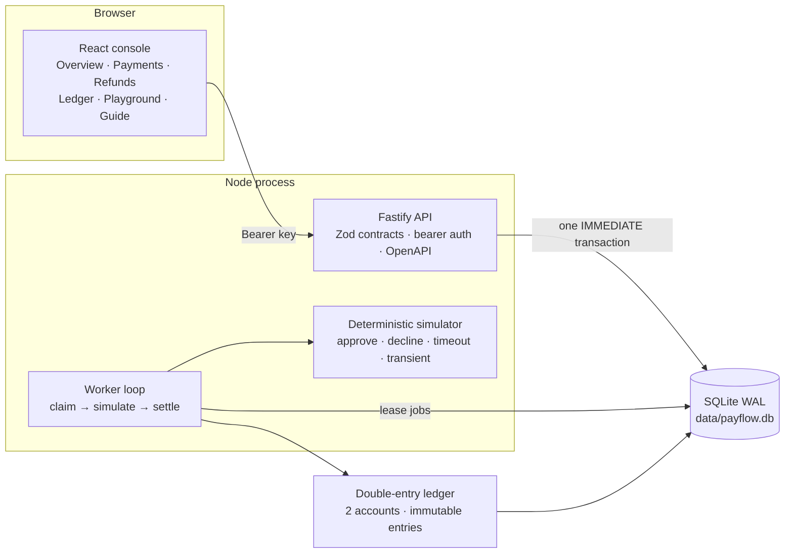
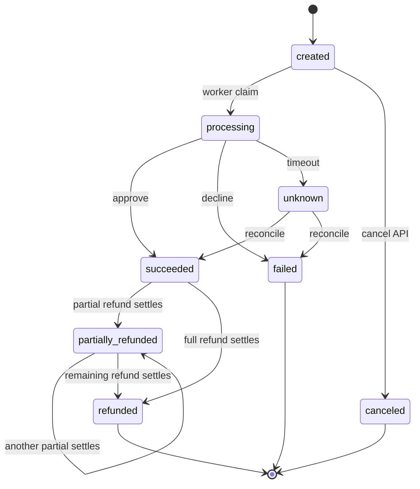
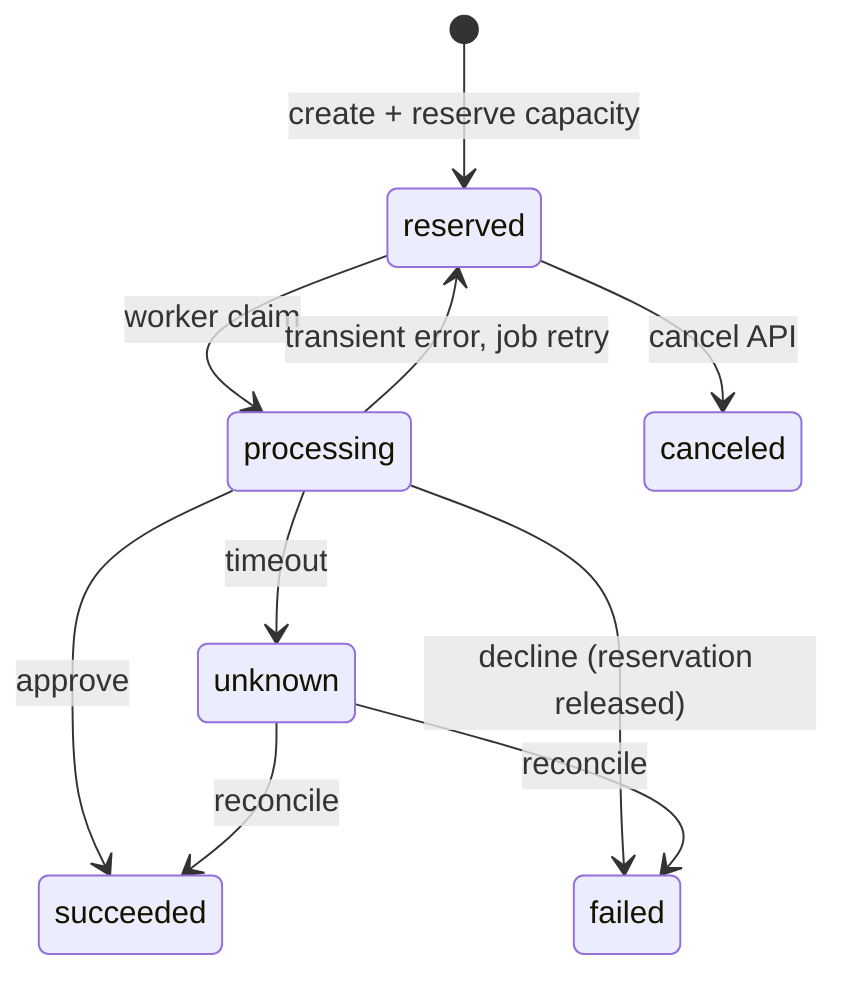

# PayFlow

A payment-processing simulator that implements the machinery of a production
payment system: idempotent writes, a guarded state machine, durable background
processing, bounded refunds, and a double-entry ledger — together with a React
operations console.

| | |
|---|---|
| **Stack** | TypeScript · Fastify 5 · Zod 4 · Drizzle ORM · SQLite (WAL) · React 19 · Vite 7 · Tailwind 4 · TanStack Query |
| **Runtime** | One Node process (API + worker), one SQLite file. No external services. |
| **Tests** | 24 API tests, CI-gated (`npm run verify`) |
| **Documentation** | This file is the reference. [`DEEP_DIVE.md`](./DEEP_DIVE.md) explains the concepts behind it. |

> **Simulation only.** No card data is accepted, no processor is contacted, and no
> money moves. All amounts are integer paise held in a local SQLite database.

---

## 1. Scope

| Included | Excluded |
|---|---|
| API-key authentication, merchant-scoped access | Real card data, PCI scope |
| Idempotent payment and refund creation | Real processors, real money |
| Explicit payment and refund state machines | Webhooks, outbox, retries to third parties |
| Durable job queue with leases, backoff, dead letters | Message brokers, distributed workers |
| Deterministic processor simulator with five scenarios | Chargebacks, disputes, payouts |
| Double-entry ledger with immutable journals | Multi-currency, fees, partial capture |
| Refund capacity reserved atomically under contention | User accounts, sessions, 2FA |
| Cursor pagination, uniform error envelope, request IDs | GraphQL, gRPC, webhooks |

---

## 2. Design decisions

| Area | Decision | Alternative rejected | Rationale |
|---|---|---|---|
| Write semantics | `202 Accepted` plus polling | `200` with a non-final body | The processor has not been called; a final-looking response invites clients to act on unsettled payments. |
| Idempotency | Client key, body fingerprint, stored response | Server-side deduplication by amount | Only the client can determine that two requests express one intent. |
| Key lifetime | 24-hour TTL, then reusable | Permanent replay | A key is a retry token, not a durable lock. |
| Uncertain outcomes | `unknown` state with reconciliation | Treating a timeout as a failure | A timeout may be a capture; failing it silently loses money. |
| Concurrency | One atomic conditional `UPDATE` | Read-then-write, row locks | No check/write window, and the pattern ports to PostgreSQL unchanged. |
| Storage | SQLite in WAL mode | PostgreSQL | Real transactions, constraints, and triggers with no infrastructure to operate. |
| Queuing | A `jobs` table with leases | Redis or a broker | Leases, backoff, and dead letters without a second service. |
| Delivery | At-least-once with idempotent handlers | Exactly-once | Exactly-once delivery is not achievable; idempotency is. |
| Money representation | Integer minor units | Floating point, decimals | Exact arithmetic and straightforward auditing. |
| Accounting | Derived balances, immutable journals | Stored balances, mutable entries | Stored balances drift; immutable entries cannot be rewritten. |
| Corrections | New compensating journal | Editing the original | History remains truthful. |
| Tenant isolation | `404` for another merchant's resource | `403` | `403` discloses that the resource exists. |
| Authentication | HMAC with a server-side pepper, timing-safe compare | Plain SHA-256 of the key | The pepper defeats offline cracking; the compare defeats timing leaks. |
| Frontend refresh | Conditional polling intervals | WebSockets | One mechanism, no connection lifecycle to maintain. |

---

## 3. Architecture



The request path, end to end:

```text
POST /v1/payments
  1. authenticate   bearer key → HMAC lookup → merchant context
  2. validate      Zod: integer amount_minor > 0, currency = INR
  3. commit        BEGIN IMMEDIATE → payment + event + job + idempotency record
  4. respond       202 { status: "created" }, Location header
  5. process       worker claims job → records attempt → calls the simulator
                   approve → succeeded + journal       decline → failed
                   error   → retry with backoff         timeout → unknown + reconcile
```

| Package | Contents | Responsibility |
|---|---|---|
| `apps/api` | Fastify, Zod, Drizzle, better-sqlite3 | HTTP surface, domain services, worker, schema, tests |
| `apps/web` | React, Vite, Tailwind, TanStack Query, Recharts | Operations console |
| root | npm workspaces | Scripts, CI, formatting |

Routes never execute SQL directly. Services own the business rules, and the
worker reuses the same service functions, so each rule has one implementation.

---

## 4. Quick start

Node 22 or newer is required. No database server or container is required.

```bash
npm install
npm run seed     # merchants, 14 days of demo history, data/demo-key.json
npm run dev      # API on :4000, console on :5173
```

| Surface | URL |
|---|---|
| Console | http://localhost:5173 |
| API | http://localhost:4000 |
| OpenAPI UI / JSON | http://localhost:4000/docs · `/docs/json` |
| Health | http://localhost:4000/health |

**Authentication.** The console offers a demo sign-in, which reads the seeded
key through the development-only `GET /v1/demo/session`, or accepts a pasted
API key. The key is written to `data/demo-key.json` with mode `0600` and is
printed once by the seed script.

```bash
KEY=$(node -e "console.log(JSON.parse(require('fs').readFileSync('data/demo-key.json','utf8')).api_key)")

curl -s -X POST http://localhost:4000/v1/payments \
  -H "Authorization: Bearer $KEY" \
  -H "Idempotency-Key: order_1042_attempt_1" \
  -H "Content-Type: application/json" \
  -d '{"amount_minor":24900,"currency":"INR","customer_id":"cus_demo_101","description":"Order #1042","simulator_scenario":"approve"}'
```

---

## 5. Domain model

### 5.1 Money

| Field | Type | Rule |
|---|---|---|
| `amount_minor` | integer | `1 … 1_000_000_000` paise; INR only |
| `amount` | string | Derived for display: `24900 → "249.00"` |
| `refunded_minor` | integer | Settled refunds |
| `refund_reserved_minor` | integer | Refunds in flight |
| `refundable_minor` | integer | `amount_minor − refunded_minor − refund_reserved_minor` |

All arithmetic is integer. Rounding occurs only at the serialization boundary.

### 5.2 Payment states



| From | Permitted next states |
|---|---|
| `created` | `processing`, `canceled` |
| `processing` | `succeeded`, `failed`, `unknown` |
| `unknown` | `succeeded`, `failed` |
| `succeeded` | `partially_refunded`, `refunded` |
| `partially_refunded` | `partially_refunded`, `refunded` |
| `failed`, `canceled`, `refunded` | terminal |

Any other transition is rejected with `409 invalid_state_transition`. Every
transition writes a `payment_events` row, which serves as both the timeline and
the audit trail.

### 5.3 Refund states



Only `succeeded` and `partially_refunded` payments are refundable. Omitting
`amount_minor` refunds the entire remaining balance.

### 5.4 Lifecycle

| Step | Implementation | Effect |
|---|---|---|
| 1 | `services/auth.ts` | Bearer key resolved to a merchant by prefix lookup and timing-safe HMAC comparison |
| 2 | `schemas.ts` | Zod validation of body, query, and path parameters |
| 3 | `services/payments.ts` | One `IMMEDIATE` transaction writes the payment, event, job, and idempotency record |
| 4 | `routes/payments.ts` | `202` with a `Location` header |
| 5 | `worker.ts` | Job leased, attempt recorded, simulator invoked |
| 6 | `worker.ts`, `services/ledger.ts` | Outcome applied; on success a balanced journal is posted |
| 7 | `routes/payments.ts` | `GET /v1/payments/{id}` returns the payment with attempts and events, always live |

---

## 6. Correctness mechanisms

### 6.1 Idempotency

Keys are scoped to `(merchant_id, operation, idempotency_key)`. The request body
is fingerprinted with `sha256` over the fields that define the operation.

| Request | Result |
|---|---|
| New key | Work executes; `202` |
| Same key, same body | Stored response replayed with `Idempotency-Replayed: true` |
| Same key, different body | `409 idempotency_key_reused` |
| Same key, request still in flight | `409 idempotency_in_progress` |
| Same key, TTL elapsed | New operation; `202` |

The record, the business write, and the stored response commit in one
transaction. A replay returns the original response body, which is normally
`status: "created"`; current state is obtained from `GET`.

### 6.2 Capacity reservation

```sql
UPDATE payments
SET refund_reserved_minor = refund_reserved_minor + :amount
WHERE id = :id
  AND status IN ('succeeded','partially_refunded')
  AND refunded_minor + refund_reserved_minor + :amount <= amount_minor;
```

A result of `changes !== 1` yields `409 refund_exceeds_remaining`. Check and
write are one statement, so concurrent refunds cannot consume the same
headroom. Declined and canceled refunds release their reservation.

### 6.3 Durable jobs

| Kind | Work |
|---|---|
| `process_payment` | Record an attempt, apply the outcome, post a journal on success |
| `reconcile_payment` | Resolve `unknown` through `lookup()` |
| `process_refund` | Record an attempt, consume or release the reservation |
| `reconcile_refund` | Resolve a refund with no reliable answer |

```text
pending ──claim──> running ──ok──> succeeded
   ▲                 ├─ throw ──> retrying ──due──> running
   │                 └─ lease expired ──> retrying
   └── canceled (aggregate canceled first)

retrying ──retry budget exhausted──> dead
```

Claiming is a conditional update, so a job has exactly one owner. A lease
(default 60 s) makes crashes recoverable: an expired lease returns the job to
`retrying`. Backoff is `min(300, 2^attempts × 2)` seconds. Handlers are
idempotent, because delivery is at-least-once.

### 6.4 Reconciliation

A timeout is never recorded as a failure. The payment moves to `unknown`, a
`reconcile_payment` job is scheduled approximately five seconds later, and
`lookup()` resolves the outcome against the stored processor reference. The
simulator is deterministic, so the same reference always resolves identically.

### 6.5 Ledger

| Event | Debit | Credit |
|---|---|---|
| Payment succeeds | `processor_clearing` (asset) | `merchant_payable` (liability) |
| Refund succeeds | `merchant_payable` | `processor_clearing` |

```text
processor_clearing   DEBIT   24,900  ─┐
merchant_payable     CREDIT  24,900  ─┴─  debits = credits ✅
```

Balances are derived, never stored: assets are `debits − credits`, liabilities
are `credits − debits`. One journal is posted per business event, enforced by
`UNIQUE (source_type, source_id)`. SQLite triggers reject `UPDATE` and
`DELETE` on ledger entries and `DELETE` on posted journals, so immutability is
enforced rather than asserted. Failed payments and failed refunds post no
journal.

---

## 7. API

Base URL `http://localhost:4000`. Requests require
`Authorization: Bearer sk_test_…`; writes require `Content-Type: application/json`.

| Method | Path | Auth | Purpose |
|---|---|---|---|
| `GET` | `/health` | No | Liveness, database check, worker state, queue depth |
| `GET` | `/v1/demo/session` | No | Seeded demo key (development only) |
| `GET` | `/v1/merchants/me` | Yes | Current merchant and environment |
| `POST` | `/v1/payments` | Yes | Create a payment; `202` |
| `GET` | `/v1/payments` | Yes | List payments; `status` filter, cursor pagination |
| `GET` | `/v1/payments/:id` | Yes | Payment with attempts and events |
| `POST` | `/v1/payments/:id/cancel` | Yes | Cancel a `created` payment |
| `GET` | `/v1/payments/:id/refunds` | Yes | Refunds of one payment, paginated |
| `POST` | `/v1/refunds` | Yes | Create a refund; `202` |
| `GET` | `/v1/refunds` | Yes | List refunds; `status` and `payment_id` filters |
| `GET` | `/v1/refunds/:id` | Yes | One refund |
| `POST` | `/v1/refunds/:id/cancel` | Yes | Cancel a reserved refund and release its capacity |
| `GET` | `/v1/accounts` | Yes | Accounts and trial balance |
| `GET` | `/v1/ledger/journals` | Yes | Posted journals, paginated |
| `GET` | `/v1/stats/overview` | Yes | Dashboard aggregates |
| `GET` | `/v1/stats/timeseries` | Yes | Daily volume, zero-filled |
| `GET` | `/docs`, `/docs/json` | No | OpenAPI 3.1 document and UI |

### 7.1 Simulator scenarios

Selected with `simulator_scenario` in the body or the `X-Simulator-Scenario`
header; the body takes precedence. `auto` is the default. Any scenario other
than `auto` is rejected when `PAYFLOW_ALLOW_SIMULATOR_CONTROLS` is false.

| Scenario | Behaviour | Result |
|---|---|---|
| `approve` | Always approves | `succeeded`, journal posted |
| `decline` | Always declines | `failed`, `card_declined`, no journal |
| `timeout` | No answer returned | `unknown`, then reconciled after approximately five seconds |
| `transient` | First attempt errors | Retry succeeds; two attempts recorded |
| `auto` | `sha256(reference) % 100` | 78% success, 3.2% decline, 6% timeout, remainder resolved through `lookup()` |

### 7.2 Pagination

Keyset pagination is used rather than offsets. The cursor encodes
`created_at|id` and orders by `created_at DESC, id DESC`, so pages remain
stable while rows are inserted.

```json
{ "data": [], "has_more": false, "next_cursor": null }
```

`limit` accepts `1 … PAYFLOW_MAX_PAGE_SIZE` and defaults to
`PAYFLOW_DEFAULT_PAGE_SIZE`.

### 7.3 Errors

All failures use one envelope:

```json
{
  "error": {
    "code": "idempotency_key_reused",
    "message": "This idempotency key was already used with a different request body.",
    "request_id": "req_..."
  }
}
```

`request_id` is also returned in the `x-request-id` response header. Validation
failures add a `details` array.

| Status | Codes |
|---|---|
| `400` | `validation_error`, `invalid_request`, `invalid_cursor`, `unsupported_currency`, `invalid_scenario` |
| `401` | `unauthorized` |
| `403` | `simulator_controls_disabled` |
| `404` | `not_found` |
| `409` | `idempotency_key_reused`, `idempotency_in_progress`, `refund_exceeds_remaining`, `payment_not_refundable`, `refund_not_cancelable`, `payment_not_cancelable`, `invalid_state_transition` |
| `429` | Rate limit, 600 requests per minute |
| `500` | `internal_error` |

### 7.4 Resource representation

```json
{
  "object": "payment",
  "id": "pay_2f8c1a…",
  "status": "created",
  "amount_minor": 24900,
  "amount": "249.00",
  "currency": "INR",
  "customer_id": "cus_demo_101",
  "description": "Order #1042",
  "failure_code": null,
  "refunded_minor": 0,
  "refund_reserved_minor": 0,
  "refundable_minor": 24900,
  "created_at": "2026-10-21T09:00:00.000Z",
  "updated_at": "2026-10-21T09:00:00.000Z"
}
```

### 7.5 Storage schema

| Table | Purpose | Principal constraints |
|---|---|---|
| `merchants` | Tenant boundary | `status` limited to `active` or `disabled` |
| `api_keys` | Hashed credentials | Unique `key_prefix` |
| `payments` | Payment state | `amount_minor > 0`; refunded plus reserved ≤ amount |
| `payment_attempts` | One row per processor call | Unique `(payment_id, attempt_number)` |
| `payment_events` | Append-only transition log | Indexed by payment and time |
| `jobs` | Durable work queue | Status, attempts, lease, next run time |
| `idempotency_records` | Replay cache | Unique `(merchant_id, operation, idempotency_key)` |
| `accounts` | Ledger accounts | Unique `(merchant_id, code)` |
| `ledger_transactions` | Journal headers | Unique `(source_type, source_id)` |
| `ledger_entries` | Journal lines | Positive amounts; immutable |
| `refunds` | Refund state | `amount_minor > 0`; references payment and merchant |

SQLite is configured on start-up with `journal_mode = WAL`,
`foreign_keys = ON`, `busy_timeout = 30000`, and `synchronous = NORMAL`. The
schema is applied idempotently; no migration framework is present, so schema
changes require the database to be rebuilt.

---

## 8. Console

| Route | Content |
|---|---|
| `/` | Volume summary, animated metrics, trend chart, status composition, live feed, ledger health |
| `/payments` | Search, filters, creation dialog, detail timeline with attempts and refunds |
| `/refunds` | Refund ledger with status filters and live totals |
| `/ledger` | Trial balance, account balances, posted journals |
| `/playground` | Request composer: presets, idempotency key, cURL output, response inspector |
| `/guide` | In-application architecture summary, invariants, endpoints, scenarios |
| Unauthenticated | Login, with demo access or an API key |

**Presentation.** Ink and parchment palette with saffron and vermilion
accents; Fraunces for display, Inter for text, JetBrains Mono for data. Status
values are semantic colours inside stamped monospace badges. Film grain, an
ambient canvas, count-up metrics, reveal-on-scroll, a live clock, and scroll
progress are used in both themes. Reduced-motion preferences are respected, and
code surfaces remain dark in the light theme.

**Data flow.** TanStack Query with a 2-second stale time and a single retry.
The console polls only where it is useful: every 1.2 seconds while a payment is
in an active state, every 2.5 seconds for the refunds of a payment, every
5 seconds for the overview, and every 15 seconds for the time series. Mutations
invalidate the affected query keys. The API key is stored in
`localStorage["payflow_api_key"]` and the theme in
`localStorage["payflow_theme"]`.

No card entry form exists. The only inputs are amounts, customer references,
and descriptions.

---

## 9. Configuration

Configuration is read from the process environment by
`apps/api/src/config.ts`. `.env.example` lists every variable. The API does not
load `.env` files; variables must be exported by the invoking environment.

| Variable | Default | Purpose |
|---|---|---|
| `PAYFLOW_ENV` | `dev` | `dev`, `test`, or `production` |
| `PAYFLOW_HOST` / `PAYFLOW_PORT` | `0.0.0.0` / `4000` | Listen address |
| `PAYFLOW_DB_PATH` | `data/payflow.db` | SQLite file, absolute or relative to the repository root |
| `PAYFLOW_API_KEY_PEPPER` | `dev-pepper-change-me` | HMAC pepper for API key hashes |
| `PAYFLOW_WORKER_ENABLED` | `true` | Start the in-process worker |
| `PAYFLOW_WORKER_POLL_MS` | `400` | Queue poll interval |
| `PAYFLOW_WORKER_LEASE_SECONDS` | `60` | Job lease duration |
| `PAYFLOW_MAX_JOB_ATTEMPTS` | `5` | Retry budget for newly enqueued jobs |
| `PAYFLOW_ALLOW_SIMULATOR_CONTROLS` | `true` | Permit forced scenarios |
| `PAYFLOW_IDEMPOTENCY_TTL_HOURS` | `24` | Idempotency key lifetime |
| `PAYFLOW_DEFAULT_PAGE_SIZE` | `25` | Default `limit` |
| `PAYFLOW_MAX_PAGE_SIZE` | `100` | Maximum `limit` |
| `PAYFLOW_CORS_ORIGIN` | `true` in development, `false` in production | CORS origin |
| `PAYFLOW_RATE_LIMIT_MAX` | `600` | Requests per minute |
| `PAYFLOW_LOG_LEVEL` | `info` | Log level |

In production the service refuses to start when the pepper is still the default
value or when simulator controls are enabled. CORS is disabled unless
configured explicitly. The worker may run in-process or as a separate process.

---

## 10. Operations

| Command | Effect |
|---|---|
| `npm run dev` | API and console |
| `npm run seed` | Merchants, demo history, `data/demo-key.json` |
| `npm test` | 24 API tests |
| `npm run typecheck` | API and console |
| `npm run build` | Console, then API |
| `npm run verify` | Quality gate: typecheck, test, build |
| `npm run format` / `npm run format:check` | Prettier write / check |
| `npm run worker -w @payflow/api` | Standalone worker |
| `npm run clean` | Remove `apps/*/dist` and `data/` |
| `npm start` | Run the built API; serves `apps/web/dist` when present |

```bash
# Initial setup
npm install && npm run seed && npm run dev

# Reset the environment
npm run clean && npm run seed

# Worker on a separate process
PAYFLOW_WORKER_ENABLED=false npm run dev:api
npm run worker -w @payflow/api

# Production-style run
npm run build && npm start
```

| Symptom | Cause | Resolution |
|---|---|---|
| Demo sign-in fails | Key file missing or stale | Run `npm run seed` |
| `401 unauthorized` | Incorrect key | Read `data/demo-key.json` or re-seed |
| Payment remains `created` | Worker not running | Check `/health`; start the worker |
| `409 idempotency_key_reused` | Same key, different body | Use a new key for a new operation |
| `409 refund_exceeds_remaining` | Amount above `refundable_minor` | Read `refundable_minor` first |
| `409 refund_not_cancelable` | Refund already processing or settled | Only reserved refunds can be canceled |
| `409 payment_not_cancelable` | Worker already started processing | Only created payments can be canceled |
| `404` for another merchant's identifier | Tenant isolation | Expected behaviour |
| `SQLITE_BUSY` | Long write, or an external process holds the file | One writer; the busy timeout is 30 seconds |
| Port already in use | Another instance is running | Stop it, or change the port and the Vite proxy |

---

## 11. Quality

| Group | Tests | Coverage |
|---|---:|---|
| Authentication | 3 | Bearer requirement, rejection of unknown keys, merchant context |
| Payments | 9 | Idempotent replay and conflict, validation, approval, decline, cancellation, transient retry, timeout reconciliation, cursor pagination, tenant isolation |
| Refunds | 6 | Partial refund with reservation and reversing journal, over-capacity rejection, release on decline, timeout reconciliation, per-payment pagination, cancellation releasing capacity |
| Ledger | 2 | Accounts start balanced; posted entries are immutable |
| Analytics | 2 | Overview and time-series aggregates; health and queue depth |
| Configuration | 2 | Config-driven page size; idempotency TTL expiry |

Tests use an isolated in-memory database, `app.inject()` in place of a network
socket, and explicit worker draining through `runDrain()`. Neither the database
nor the worker is mocked.

CI runs `format:check`, `typecheck`, `test`, and `build` on Node 22
(`.github/workflows/ci.yml`). `npm run verify` executes the same gate locally.

Not covered: browser tests, multi-process stress tests, real HTTP load, and
failure injection outside the simulator.

---

## 12. Repository layout

```text
apps/api/src/
├── app.ts              Fastify app, auth decorator, error handler, Swagger, static console
├── server.ts           Boot, graceful shutdown, embedded worker
├── worker-cli.ts       Standalone worker process
├── config.ts           Environment parsing and production guards
├── db.ts               SQLite connection, pragmas, schema bootstrap, migrations
├── schema.ts           Drizzle table definitions
├── schema-sql.ts       Raw schema, indexes, immutability triggers
├── domain.ts           Statuses, transitions, errors, identifiers, cursor, simulator
├── schemas.ts          Zod request and response contracts
├── seed.ts             Merchants and fourteen days of synthetic history
├── routes/             HTTP surface: health, payments, refunds, read
├── services/           auth · idempotency · jobs · ledger · payments · refunds ·
│                       serializers · stats
└── app.test.ts         24 API tests

apps/web/src/
├── App.tsx             Router, query client, authentication gate
├── index.css           Design tokens, typography, texture, motion
├── components/         layout · ui · status · ambient · motion · chart · dialogs
├── lib/                api · auth · theme · utils
└── pages/              overview · payments · refunds · ledger · playground · guide · login
```

| Change | Files |
|---|---|
| Status or transition | `domain.ts`, `schemas.ts`, `schema-sql.ts` |
| Endpoint | `routes/*`, a service function, a Zod contract |
| Response field | `services/serializers.ts`, `schemas.ts`, `web/src/lib/api.ts` |
| Ledger rules | `services/ledger.ts` |
| Retry or lease behaviour | `services/jobs.ts`, `domain.ts`, `config.ts` |
| Simulator scenario | `domain.ts`, `web/src/lib/api.ts`, playground presets |
| Visual language | `apps/web/src/index.css` |
| Console page | `pages/*`, `App.tsx`, `layout.tsx` |

---

## 13. Known limitations

- SQLite permits a single writer. The patterns used here port to PostgreSQL
  unchanged, but no load testing has been performed there.
- No migration framework exists; schema changes require rebuilding
  `data/payflow.db`.
- One embedded worker is the default. Additional workers are safe, but SQLite
  serializes their writes.
- There are no webhooks, outbox, metrics, or tracing backends. Structured logs
  and request identifiers only.
- There is no real processor, no card data, no PCI scope, and no multi-currency,
  fees, chargebacks, disputes, or payouts.
- Authentication is limited to bearer API keys; there are no user accounts.

---

## 14. Further reading

[`DEEP_DIVE.md`](./DEEP_DIVE.md) documents the concepts underlying the
implementation: the twelve ideas the system is built on, seven end-to-end
traces including a refund race and a worker crash, the accounting algebra
worked through numerically, change recipes, a debugging playbook, and eighteen
hands-on exercises.
